# Digital Robotics Platform v2 — High-Level Design

Version 0.2 (draft for review) · 2026-11-06 · Owner: T.N · Implements [SRS-v2](SRS-v2.md) v0.2

> This document explains *how* the platform is built: the parts, how they talk, where data lives, and the main design decisions. It is written to be edited. The design decisions in section 14 were confirmed by the owner on 2026-11-06.

## 1. Purpose and scope

The HLD turns the SRS into an engineering shape:
- the system structure;
- the module boundaries;
- the access-control model;
- the data and finance design;
- the front-end architecture;
- the cross-cutting concerns;
- the deployment on shared hosting.

Class-level detail (exact columns, method signatures) belongs in the low-level design or the code. Requirement IDs (`FR-…`, `NFR-…`) point back to the SRS.

## 2. Architecture overview

### 2.1 Style
A **modular monolith**: one Laravel 13 application, one MySQL database and one deployable artefact.
- Inertia connects Laravel controllers to Vue pages, so there is **no separate REST API** to build or secure.
- Modules are separated by folder and by service boundaries, not by network.

This fits a small team, shared hosting (SRS 2.4), and a domain where every module touches teams.

### 2.2 System context

```mermaid
flowchart LR
    V[Visitor] -->|HTTPS| P
    M[Team member<br/>captain · coach · member · viewer] -->|HTTPS| W
    S[Department staff<br/>admin · member] -->|HTTPS| C
    SA[Super admin] -->|HTTPS| C
    subgraph APP[Digital Robotics Platform · Laravel 13 monolith]
        P[Public website<br/>/en · /ar]
        W[Team workspace<br/>/t/&#123;team&#125;]
        C[Organisation console<br/>/admin]
    end
    APP --> DB[(MySQL 8)]
    APP --> FS[Media storage<br/>public disk]
    APP --> SMTP[SMTP mail]
    APP --> CF[Cloudflare Turnstile]
    APP --> GF[Google Fonts]
    CRON[Host cron · every minute] --> APP
```

### 2.3 Containers inside the application

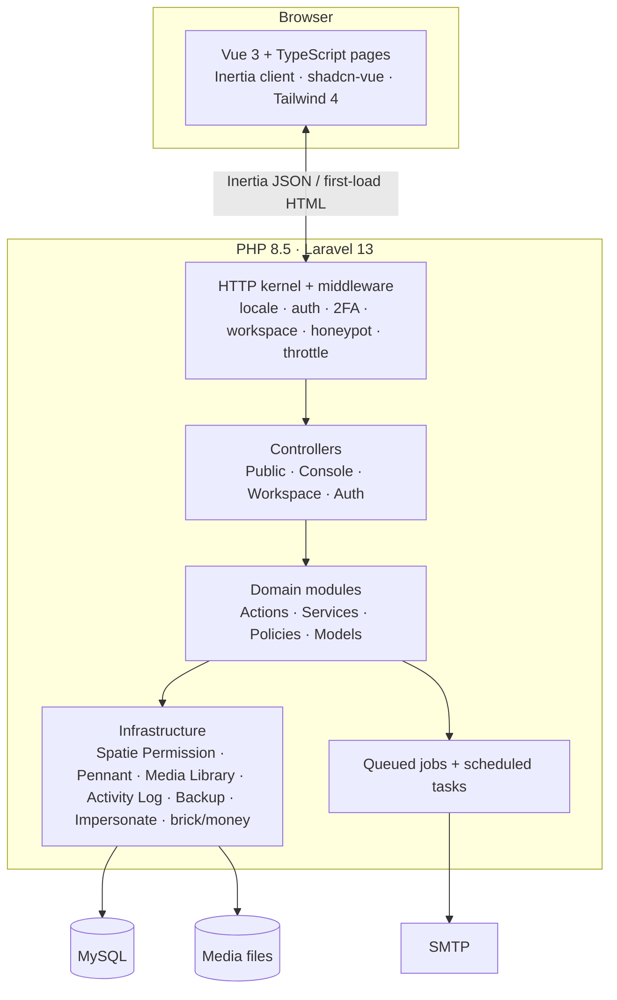

**Main flows:**
1. On the first request for any page, the server returns full HTML: the root template with SEO meta tags, plus the page props as JSON.
2. On later navigation, the Inertia client asks for the same URL and receives only JSON props. It swaps the Vue page without a full reload.
3. Writes go through Form Requests, then a Policy, then a domain Action or Service inside a database transaction. They return a redirect with a flash message, which shows as a toast.
4. Slow work (image conversions, mail, nightly checks, backups) is queued. The host cron drains the queue, because shared hosting cannot keep a worker daemon running.

## 3. Technology stack

| Layer | Choice | Why / notes |
| --- | --- | --- |
| Runtime | PHP 8.5, Laravel 13 | Current versions; all approved packages support them |
| Database | MySQL 8 (InnoDB, utf8mb4) | Available on shared hosts; JSON columns and row locks |
| Front end | Inertia, Vue 3 + TypeScript, Vite | One codebase for all UIs; no API layer |
| UI kit | shadcn-vue (Reka UI) + Tailwind CSS 4 | Accessible primitives; RTL through logical utilities |
| Routes in JS | Laravel Wayfinder | Typed, generated route helpers; no hard-coded URLs |
| i18n | Laravel `lang/*` + `laravel-vue-i18n` | One source of translations for PHP and Vue |
| Auth | Laravel Fortify (starter kit) | Login, reset, 2FA (TOTP), password confirmation |
| Authorisation | spatie/laravel-permission v8 (teams mode) + Policies | Roles and permissions per workspace |
| Feature flags | laravel/pennant | Team features: tier default plus override |
| Media | spatie/laravel-medialibrary 11 | Uploads, conversions (WebP), collections |
| Audit | spatie/laravel-activitylog 5 | Who did what, including impersonation |
| Money | brick/money | Exact arithmetic, ISO currencies (LYD = 3 decimals) |
| Impersonation | lab404/laravel-impersonate | Support access with guards |
| Spam | spatie/laravel-honeypot (Inertia mode), njoguamos/laravel-turnstile | Public and auth forms |
| Backups | spatie/laravel-backup | Daily database and media archives |
| Quality | Pest 4, Pint, Larastan (optional), ESLint, Prettier, vue-tsc | Tests and style for both halves |

## 4. Application structure

### 4.1 Module map
Each module owns its models, actions, policies, requests, resources and pages. Modules call each other through **services or actions**, never by writing another module's tables directly.

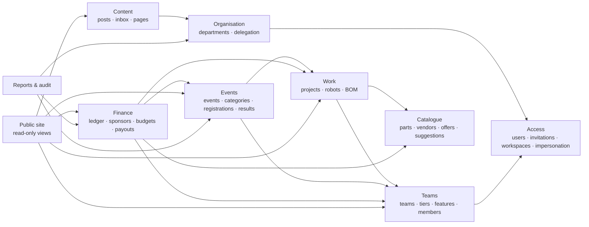

Arrows mean "depends on". **Access** is the base module. **Public site** only reads, through public scopes.

### 4.2 Code layout
`app/Domain/<Module>` keeps modules self-contained, while Laravel's normal folders stay usable.

```text
app/
  Domain/
    Access/        Models, Actions, Policies, Services (WorkspaceContext, InvitationService)
    Organisation/  Department, DepartmentPermissionService
    Teams/         Team, Tier, Features/ (Pennant feature classes), TeamMemberService
    Work/          Project, Robot, BomLine, BomCalculator
    Catalogue/     Part, Vendor, VendorOffer, SuggestionService
    Events/        Event, EventCategory, Registration, EntryRules, RegistrationService
    Finance/       FinanceAccount, LedgerTransaction, LedgerService, SplitCalculator, PayoutService
    Content/       Post, ContactMessage
  Http/
    Controllers/{Public,Console,Workspace,Auth}/
    Middleware/    SetLocale, ResolveWorkspace, EnsureNotImpersonating, HandleInertiaRequests
    Requests/      Form Requests per action
    Resources/     API Resources used as Inertia props
resources/js/
  pages/{public,console,workspace,auth,errors}/
  layouts/       PublicLayout, AppShell (console + workspace), AuthLayout
  components/    ui/ (shadcn-vue), data-table/, forms/, public/
  lib/           i18n, money formatting, permissions helper
```

**Decided:** code is grouped by module under `app/Domain` (D-07).

### 4.3 Layers inside a module

| Layer | Responsibility | Rule |
| --- | --- | --- |
| Route + middleware | URL, locale, auth, workspace, throttle, spam | No business rules |
| Form Request | Validation and messages | Shape of the input only |
| Policy | May this user do this here? | Combines role/permission + team feature + record state |
| Controller | Orchestrates one request | Thin: calls one Action/Service, returns an Inertia page or redirect |
| Action / Service | Business rules, transactions, events | The only place that writes; one public method per use case |
| Model | Relations, casts, scopes (`scopePublic`, `scopeForWorkspace`) | No HTTP knowledge |
| Resource | Props sent to Vue | Never leaks fields the user may not see |
| Vue page | Presentation | Hides actions using shared permissions, but never relies on that for security |

## 5. Request lifecycle and routing

### 5.1 Route groups

| Group | Prefix | Middleware (in order) | Controllers |
| --- | --- | --- | --- |
| Public | `/{locale}` (`en`, `ar`) | web, SetLocale, throttle (forms), honeypot + Turnstile (forms) | `Public\*` |
| Auth | `/login`, `/two-factor`, `/invitations/{token}` | web, guest or auth, throttle, honeypot, Turnstile | Fortify + `Auth\InvitationController` |
| Hub | `/hub` | auth, 2fa-if-required | `HubController` |
| Console | `/admin` | auth, 2fa-if-required, ResolveWorkspace(department or global), not-impersonating (sensitive routes) | `Console\*` |
| Workspace | `/t/{team:slug}` | auth, ResolveWorkspace(team), team-active (writes) | `Workspace\*` |
| System | `/sitemap.xml`, `/up` | none | `SitemapController`, health |

### 5.2 A workspace request, step by step

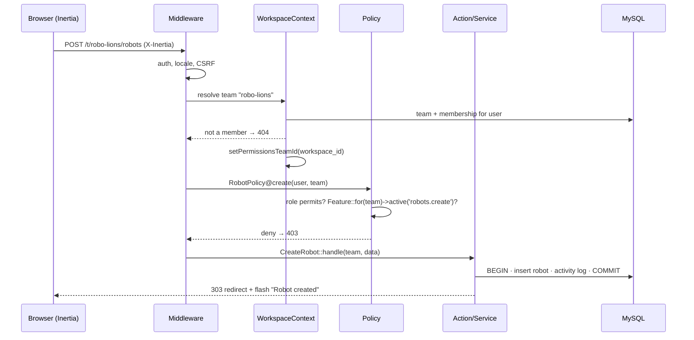

## 6. Identity and access design

### 6.1 Workspaces: one scope key for teams and departments
Spatie Permission's "teams" feature scopes roles and permissions by one foreign key. Teams and departments both need scoping, so both point at a shared **`workspaces`** row. The Spatie team key is `workspace_id` (SRS NFR-DC-02).

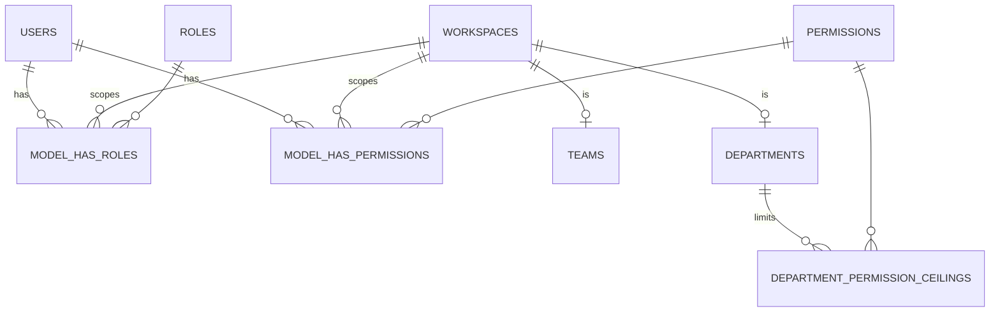

- **Global scope (`workspace_id = null`):** the `super-admin` role only. `Gate::before` returns true for it.
- **Team workspace:** the roles `captain`, `coach`, `member` and `viewer`. Each role carries a fixed permission set (SRS B.3).
- **Department workspace:**
  - the role `department-admin`, which holds everything in the ceiling plus `<area>.approve` and `members.manage`;
  - members get **direct permissions**, one per granted `<area>.view` or `<area>.edit`.
- **Multiple memberships:** a user can be in many workspaces. `WorkspaceContext` sets the active one per request from the URL. Nothing about the active workspace is stored in the session, which prevents "wrong team" bugs when several tabs are open.

### 6.2 Department delegation algorithm (FR-DEP-05…08)

```text
grant(admin, member, permission, department):
  require admin is department-admin of department
  require permission ∉ RESERVED
  require permission ∈ ceiling(department)
  require permission.action ≠ "approve"
  give member the direct permission, scoped to department.workspace_id
  log activity

setCeiling(superAdmin, department, newCeiling):
  removed = oldCeiling − newCeiling
  revoke removed from every member and the admin role, in one transaction
  log activity
```

`DepartmentPermissionService` is the only code that changes department permissions. A database-level check (a test plus a nightly consistency job) ensures that no member holds a permission outside the ceiling.

### 6.3 Team features with Pennant (FR-TEAM-04…06)
- Each feature is a class in `Domain/Teams/Features`, for example `RobotsCreate` or `MembersMax`.
- The class's `resolve(Team $team)` returns the team's override from `team_feature_overrides` if there is one, otherwise the tier default (`$team->tier->features['robots.create']`).
- **Overrides live in their own table**, `team_feature_overrides`, because Pennant also stores resolved values and cannot tell an override from a cached default.
- **Setting or removing an override** writes that table, then calls `Feature::for($team)->forget($name)`. Pennant resolves again on the next check.
- **Changing a tier** forgets the Pennant cache for the tier's teams, so they pick up the new defaults. Teams with overrides keep them.
- Full detail: [LLD 03 §3](LLD-v2/03-teams.md).

### 6.4 The authorisation decision
Every Policy method follows the same three checks:

```text
allowed =  workspaceRole/permission allows action         (Spatie, scoped)
        ∧  (team context ⇒ team.status = active ∧ feature active)   (Pennant)
        ∧  record-state allows it (e.g. event is open, transaction is draft)
super-admin bypasses via Gate::before, except routes guarded by EnsureNotImpersonating
```

### 6.5 Invitations

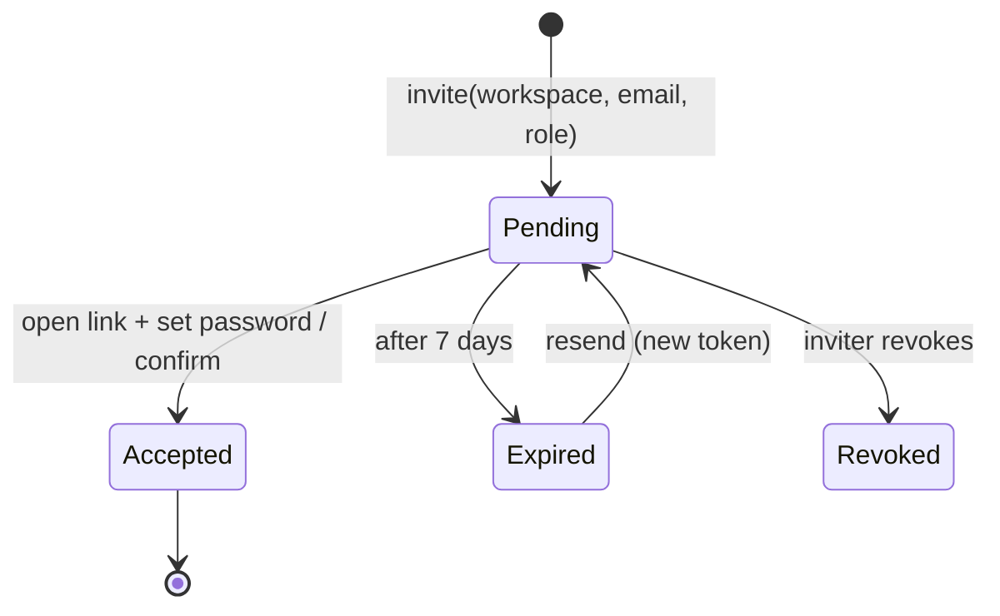

- The token is random, stored hashed, and single-use.
- Accepting runs in one transaction: create the user or reuse the existing account, create the membership, assign the role in the workspace, and mark the invitation accepted.

### 6.6 Impersonation (FR-ACC-12…15)
- **Who:** `User::canImpersonate()` is true only for `super-admin`; `canBeImpersonated()` is false for a super admin.
- **Blocked actions:** the `EnsureNotImpersonating` middleware guards security settings, finance approve/post, permission grants and starting another impersonation. It returns 403.
- **Logging:** listeners on the package's `TakeImpersonation` and `LeaveImpersonation` events write activity entries. A request-level tap adds `impersonator_id` to every activity logged during the session.

## 7. Domain modules

Each module is listed with what it owns, its main services and its state machines.

### 7.1 Teams and workspace (FR-TEAM, FR-WS)
- **Owns:** `teams`, `tiers`, `team_members`, Pennant feature values.
- **`TeamMemberService`:**
  - add or invite, enforcing `members.max` under a row lock on the team;
  - change role while keeping exactly one captain;
  - transfer captaincy;
  - remove or leave.
- **Team status:** pending → active ⇄ suspended → archived. Writes in the workspace need `active`.

### 7.2 Work: projects, robots, BOM (FR-WS-05…09)
- **Owns:** `projects`, `robots`, `bom_lines`.
- **`BomCalculator`:** works out line totals, robot totals and the shopping list grouped by vendor using brick/money. Totals are always computed, never stored, so price changes show up immediately.
- **Availability:** a BOM line whose part is archived or whose offer is removed is flagged `unavailable` (FR-WS-09).

### 7.3 Catalogue (FR-CAT)
- **Owns:** `part_categories`, `parts`, `vendors`, `vendor_offers`.
- **Status on parts, vendors and offers:** `approved`, `suggested`, `rejected` or `archived`.
  - `scopeVisibleTo(team)` returns approved items plus that team's own suggestions.
- **`SuggestionService`:** approve, reject or merge. Merging repoints the team's BOM lines to the existing item, then notifies the team.

### 7.4 Events (FR-EVT)
- **Owns:** `events`, `event_categories`, `registrations`, `registration_robots`, `event_results`.
- **`EntryRules`:** a pure, testable class. Given an event, a category, a team, robots and members, it returns a list of rule violations. Add, apply and approve all call it. A department admin's override stores the reason.
- **`RegistrationService`:** locks the event row, counts approved registrations against capacity, and snapshots members on approval.

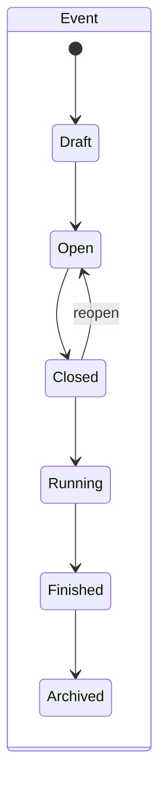

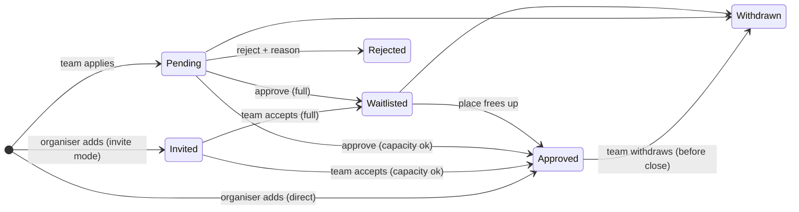

### 7.5 Content and inbox (FR-CON)
- **Owns:** `posts`, `contact_messages`, `featured_items`.
- **Posts:** draft → scheduled → published. A scheduled task publishes posts when their time comes.
- **Contact messages:** go to the inbox department set in the settings, with status new → in progress → closed.

### 7.6 Finance (FR-FIN)
See section 9.

### 7.7 Public site (FR-PUB)
- Read-only controllers that use only `Model::public()` scopes, never policies. The scopes are listed below.
- Responses are cached per locale for 5 minutes. Saving a related model bumps a per-module version number that is part of the cache key, so the next request rebuilds it. Cache tags are not used because the database cache store does not support them.

| Model | `scopePublic()` |
| --- | --- |
| Team | status active ∧ is_public ∧ Feature `public.profile` |
| Project | published ∧ team public |
| Robot | is_public ∧ team public |
| Event | visibility public ∧ status ≠ draft, or invite-only ∧ results published |
| Post | published_at ≤ now |
| Sponsor | public_consent ∧ is_active |

## 8. Data architecture

### 8.1 Core entity relationships

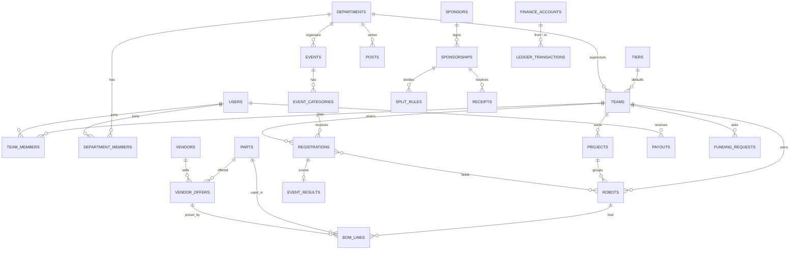

### 8.2 Conventions

| Topic | Rule |
| --- | --- |
| Keys | `bigint` auto-increment IDs. Public URLs use unique `slug`s; tokens use random strings. |
| Bilingual text | `*_en` and `*_ar` columns. The model accessor `localized('title')` falls back to English. **Decided** (D-08); spatie/laravel-translatable is not used. |
| Money | `*_minor` as `bigint`, plus a `currency` `char(3)` and `rate_to_lyd` `decimal(18,8)` on finance rows. Always handled as brick/money objects in code. |
| Time | `timestamp` in UTC. Shown in Africa/Tripoli. Event dates use `datetime` with the venue time zone. |
| Status fields | PHP backed enums cast on the model. Transitions only through services. |
| Deletion | Soft deletes for user-facing records (teams, projects, robots, parts, events, posts). Finance rows are **never** deleted (NFR-FIN-03). |
| Ownership | Every team-owned table has `team_id` and a `scopeForWorkspace()`. Workspace isolation tests cover each one. |
| Media | Media Library collections per model: `logo`, `photos`, `gallery`, `datasheet`, `proof`. Conversions: `thumb` 320, `card` 800, `large` 1600, all WebP. |
| Indexes | Foreign keys, `(team_id, status)`, `(event_id, status)`, `(account_id, status, date)` on the ledger, and `published_at` on public content. |

## 9. Finance design

### 9.1 Ledger model
**Single-entry transfers between accounts.** Each transaction moves an amount *from* one account *to* another, so it is double-entry by construction: one row is one debit plus one credit. The model is simpler than a full general ledger but keeps the same guarantees:

- **Account types:** general fund, earmarked fund, reinvestment pool, team budget, project budget, event budget, external (sponsor, vendor, person, other income).
- **Income** is posted from `external:sponsor X` → `fund`. **Spending** is posted from `budget` → `external:vendor Y`. A **payout** is posted from `fund or budget` → `external:person Z`.
- **Balance** = Σ in − Σ out over posted transactions.
  - A `balance_minor` cache column on `finance_accounts` is updated inside the same database transaction that posts.
  - The nightly `finance:verify` command recomputes every balance from the rows and alerts the super admin on any mismatch (NFR-FIN-01).
- **Immutability:** once status is `posted`, the model refuses updates (a model event throws). A correction creates a new transaction with `reverses_id` pointing at the original.

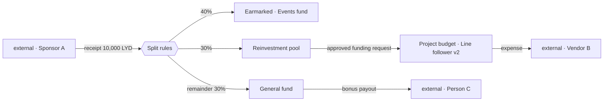

### 9.2 Transaction states

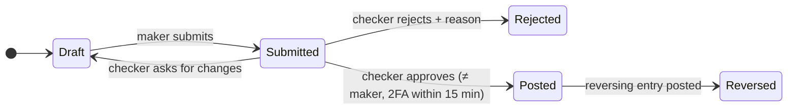

- Funding requests, expenses and payouts have their own states (for example payout: draft → submitted → approved → paid). They **create** ledger transactions when they reach approved or paid. They never edit an existing transaction.
- **`LedgerService::post()`:**
  1. locks both accounts (`SELECT … FOR UPDATE`);
  2. checks the fiscal period is open;
  3. checks the source balance (unless an override reason is given);
  4. writes the row;
  5. updates both balance caches;
  6. logs the activity;

  all in one database transaction.

### 9.3 Split calculation (FR-FIN-13…14)
`SplitCalculator::propose(Receipt $r, Sponsorship $s): array<Line>`:
1. Apply the fixed-amount rules in position order. Each takes `min(fixed, remaining)`.
2. Apply the percentage rules to the remaining amount, using brick/money `allocate()` so rounding never loses or invents a dirham.
3. Send whatever remains to the sponsorship's default account, or the general fund.
4. Return proposed lines. The finance user may edit them before submitting. On approval, each line becomes one ledger transaction from `external:sponsor` to the target account.

### 9.4 Multi-currency
Each transaction stays in its own currency with a stored `rate_to_lyd`. Balances are kept per account currency; LYD totals in reports use the stored rates. There is no automatic currency conversion. **Decided** (D-10): each transaction keeps its original currency and amount.

## 10. Front-end architecture

### 10.1 Page shells

| Shell | Used by | Contents |
| --- | --- | --- |
| `PublicLayout` | `/en`, `/ar` pages | Ported v1 redesign: sticky header, nav, language switch, footer; locale-aware links |
| `AppShell` | Console and workspace | Sidebar from the current workspace's allowed areas, workspace switcher, breadcrumbs, user menu, impersonation banner, toasts, light/dark |
| `AuthLayout` | Login, 2FA, invitation, reset | Minimal centred card |

### 10.2 Shared props (`HandleInertiaRequests`)

```text
auth.user            { id, name, locale, avatar }
auth.impersonating   null | { originalName }
workspace            null | { type: team|department, id, slug, name }
can                  { 'robots.create': true, ... }   // only for the active workspace
features             { 'parts.access': true, 'members.max': 8, ... } // teams only
flash                { success?, error? }
locale, dir          'ar', 'rtl'
honeypot             spatie Honeypot object (public + auth pages)
turnstile            { siteKey }
```

`can` and `features` only hide or show UI. Every rule is enforced again on the server (UI-06, FR-ACC-08).

### 10.3 Reusable building blocks
- **`DataTable`:** server-side pagination, sorting and filters through query string, using `router.get` with `preserveState` and `preserveScroll`. It is fed by a `PaginatedResource` prop.
- **`useHoneypotForm()`:** wraps Inertia's `useForm` and adds the honeypot fields. **`Turnstile.vue`:** loads Cloudflare's script and fills the `cf-turnstile-response` field.
- **`MoneyInput` and `formatMoney()`:** currency-aware with locale digits; display only. Arithmetic happens on the server.
- **`MediaUploader`:** chunk-free uploads to Media Library endpoints, with previews and the size limits from NFR-SEC-05.

### 10.4 Localisation, RTL and SEO
- `SetLocale`: the URL prefix decides on public pages; the user setting decides elsewhere. The root template sets `<html lang dir>`. Vue mounts only after `laravel-vue-i18n` has loaded the locale's JSON.
- RTL: only logical Tailwind utilities (`ms-`, `pe-`, `start-`, `text-start`). Icons that point in a direction mirror with `rtl:-scale-x-100`.
- SEO without SSR (CI-04):
  - public controllers return a `meta` prop;
  - the **root Blade template prints those tags server-side on the first load**;
  - Vue `<Head>` updates them on client-side navigation;
  - `sitemap.xml` is plain XML.

## 11. Cross-cutting concerns

| Concern | Design |
| --- | --- |
| Spam protection | Honeypot middleware on public and auth POST routes; Turnstile rule on contact, login, reset and invitation acceptance; named rate limiters (`contact` 3/min, `auth` 5/min, `apply` 10/min) |
| Authentication | Fortify: password rules (min 10, `uncompromised()`), TOTP 2FA required for the super admin and department admins (`2fa-if-required` middleware), password confirmation before security pages |
| Security headers | Middleware sets CSP (self, the Turnstile domain, Google Fonts), `X-Frame-Options: DENY`, `Referrer-Policy: strict-origin-when-cross-origin`, HSTS in production |
| Audit | `LogsActivity` on audited models. Custom `workspace_id` and `impersonator_id` properties. Activity log v5 buffering is flushed after the response. Report pages filter by workspace, subject and causer. |
| Notifications | Laravel Notifications with `mail` plus `database` channels: invitations, registration status, suggestion decisions, funding and payout decisions, contact alerts. Mail is queued. |
| Queue | Database driver. The cron runs `schedule:run` every minute; the scheduler runs `queue:work --stop-when-empty --max-time=50` each minute without overlapping. |
| Scheduled tasks | Publish scheduled posts (every minute), expire invitations (hourly), `finance:verify` and the department-ceiling consistency check (nightly), `backup:run` + `backup:clean` (daily 02:00), activity log pruning (monthly, keeping finance entries) |
| Caching | Database cache store. Public-page fragments use versioned keys. Permission cache via Spatie (cleared on role changes). Pennant uses its database store. |
| Errors | One Inertia `Error.vue` for 403, 404, 419, 429, 500 and 503, localised. Exceptions are logged with daily rotation; there is no exception detail in production. |
| Files | Media Library on the `public` disk. If symlinks are not allowed, the disk root is `public/media` (SRS 2.4). Private documents (agreements, proofs) go on the `local` disk and are served through an authorised controller. |
| Localisation of data | `localized()` accessor; dates and numbers are formatted with the active locale's words and month names, but **always with Western digits (0-9)** in both languages (D-11). PHP uses the `latn` numbering system; Vue uses `Intl` with `numberingSystem: 'latn'`. |

## 12. Deployment architecture (shared hosting)

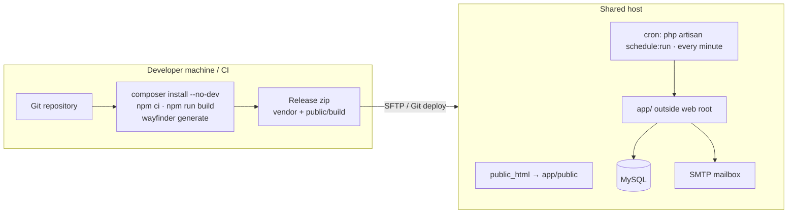

| Step | Command / action |
| --- | --- |
| 1. Maintenance on | `php artisan down --retry=30` |
| 2. Upload release | Replace `app/` (keep `storage/` and `.env`) |
| 3. Migrate | `php artisan migrate --force` |
| 4. Optimise | `php artisan optimize` (config, routes, views, events cache) |
| 5. Maintenance off | `php artisan up` |

**Environments:**
- **local:** Herd, `digital-platform.test`, Turnstile test keys, mail to log.
- **staging (optional):** a subdomain on the same host.
- **production.**

**CI** (GitHub Actions, optional): Pint, Pest, ESLint, vue-tsc and build on every push; it produces the release zip.

## 13. Testing strategy

| Level | Tooling | What it covers |
| --- | --- | --- |
| Unit | Pest | `EntryRules`, `SplitCalculator`, `BomCalculator`, `DepartmentPermissionService` (ceiling and reserved), money formatting |
| Feature | Pest + `assertInertia` | Every controller action: allow and deny per role and feature, workspace isolation, state transitions, validation, public scopes |
| Finance invariants | Pest | Sum of posted equals balance; reversals; maker-checker; period lock; overspend refusal |
| Security | Pest | Honeypot and Turnstile rejection, throttling, impersonation guards, 2FA requirement |
| Front end | vue-tsc, ESLint; optional Vitest for composables | Types and lint; `useHoneypotForm` and `formatMoney` |
| Smoke | Manual browser walkthrough per phase (plan "Verification") | Both locales, RTL, mobile, dark mode |

## 14. Key design decisions

| # | Decision | Alternatives considered | Reason |
| --- | --- | --- | --- |
| D-01 | Modular monolith on Laravel 13 | Separate API + SPA; microservices | One deployable on shared hosting; small team |
| D-02 | Inertia + Vue, no SSR | Nuxt SPA + API; Blade/Livewire | Owner prefers Vue; no Node on the host; SEO meta printed server-side |
| D-03 | Shared `workspaces` key for Spatie teams | Two permission systems; custom ACL | One authorisation model for teams and departments |
| D-04 | Pennant for team features | JSON column on teams; Spatie permissions on teams | Tier defaults plus stored overrides; first-party |
| D-05 | Transfer-based ledger with balance cache and nightly verification | Full double-entry GL package; mutable balances | Auditable, simple to reason about, fits sponsor splits |
| D-06 | brick/money with integer minor units | Floats or decimals; akaunting/laravel-money | Exact rounding (`allocate`) for splits; ISO precision |
| D-07 | `app/Domain/<Module>` layout | Flat Laravel folders | Keeps 9 modules separable (confirmed) |
| D-08 | Separate `_en`/`_ar` columns | spatie/laravel-translatable | Simple queries and search (confirmed) |
| D-09 | Database queue drained by cron | Redis/Horizon | Shared hosting has no daemons |
| D-10 | Each transaction keeps its own currency, with a stored rate to LYD | Convert everything to LYD at entry | Keeps the original amount for sponsor statements (confirmed) |
| D-11 | Western digits (0-9) everywhere, including Arabic pages | Arabic-Indic digits, or a per-user choice | Owner decision; consistent numbers in money and reports (confirmed) |
| D-12 | Registration states as drawn in 7.4 | Fewer states | Covers organiser-added, applied, waitlisted and withdrawn entries (confirmed) |

## 15. Risks

| Risk | Impact | Mitigation |
| --- | --- | --- |
| Host lacks PHP 8.5 or cron | Blocks go-live | Confirm before phase 1 (SRS C-01); fall back to a small VPS |
| Cron-drained queue is slow | Mail and thumbnails delayed up to 1 minute | Acceptable; send critical mail synchronously (password reset, invitations) |
| Spatie teams scope set wrongly | Permission leaks between workspaces | Single `WorkspaceContext`, isolation tests for every module, never store the active workspace in the session |
| Finance balance drift | Wrong reports | Locked posting, immutable rows, nightly verify |
| Client-side SEO limits | Weaker indexing than SSR | Server-printed meta tags, sitemap, fast first load; revisit SSR if hosting changes |

## 16. Traceability

| SRS section | HLD section |
| --- | --- |
| 3.1 Interfaces | 2, 5.1, 10, 12 |
| 3.2 Accounts and access | 6.1, 6.5, 6.6, 11 (auth) |
| 3.3 Departments | 6.1, 6.2 |
| 3.4 Teams and tiers | 6.3, 7.1 |
| 3.5 Workspace | 7.1, 7.2, 10 |
| 3.6 Catalogue | 7.3 |
| 3.7 Events | 7.4 |
| 3.8 Content, inbox, reports | 7.5, 11 (audit) |
| 3.9 Finance | 9 |
| 3.10 Public website | 7.7, 10.4 |
| 3.11–3.13 NFRs | 8.2, 11, 12, 13, 15 |
