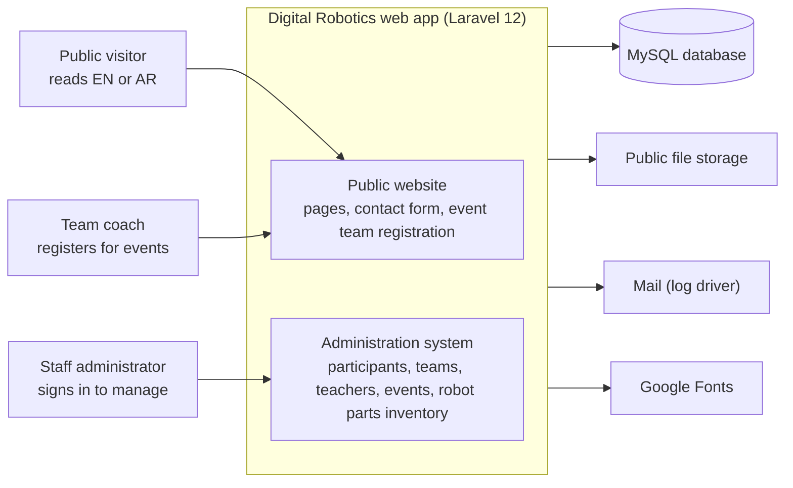

# Digital Robotics Platform — Software Requirements Specification

IEEE Std 830-1998 structure · Baseline: current implementation · 2026-11-06 · T.N

## 1. Introduction

This SRS records what the Digital Robotics platform does today, as built, so the planned overhaul can change, drop or add requirements against a known baseline. Every requirement below was read from the running code base (Laravel 12) on the date above; nothing is aspirational unless marked **[Gap]**.

### 1.1 Purpose

The document gives the product owner, developers and reviewers one shared list of current behaviour. It is the input for scoping the functional overhaul: each requirement can be kept, modified or retired, and missing needs can be added with context.

### 1.2 Scope

The product is a single web application for **Digital Robotics Foundation Libya** with two parts:

- **Public website** (English and Arabic): presents the foundation, public teams, projects, news and events, takes contact messages and accepts event team registrations.
- **Administration system** (staff only, login required): manages participants, teams, trainers, class topics, vendors, robot parts and categories, events and event team registrations, and the staff user's own profile.

Out of scope today: payments, learner self-service accounts, e-mail campaigns, mobile apps and a public API.

### 1.3 Definitions, acronyms and abbreviations

| Term | Meaning |
| --- | --- |
| Administrator / staff user | An authenticated `User` who signs in to the administration system |
| Participant | A person registered with the foundation (student, member, coach), stored in `participants` |
| Team | A foundation team that groups participants; may be public or suspended (archived) |
| Trainer / teacher | A participant who teaches one or more topics (classes) |
| Topic / class | A subject a trainer can teach |
| Event | A competition or gathering with dates, age groups and a member cap |
| Event team | A team registration submitted for one event, optionally linked to a foundation team |
| Public entry | A project or news article published on the public site |
| Locale | Interface language: `en` (LTR) or `ar` (RTL) |
| SRS | Software Requirements Specification |
| FR / NFR | Functional / non-functional requirement |
| RTL | Right-to-left text direction |

### 1.4 References

- IEEE Std 830-1998, *IEEE Recommended Practice for Software Requirements Specifications* (structure followed here; superseded by ISO/IEC/IEEE 29148, but still the requested format).
- Project source code, routes (`routes/web.php`, `routes/auth.php`) and database migrations.
- Laravel 12, Livewire 3, Pest 3 documentation.

### 1.5 Overview

Section 2 describes the product context, its users and constraints. Section 3 lists the specific requirements: external interfaces (3.1), functional requirements for the public website (3.2) and the administration system (3.3), then non-functional requirements (3.4 to 3.6). Appendix A summarises the data model and Appendix B lists gaps and open questions to settle before the overhaul.

Requirement IDs follow `FR-<module>-<nn>`; priority is not assigned yet because the baseline describes current behaviour.

## 2. Overall description

The platform is one self-contained Laravel 12 web application with a shared database; it serves the public website and the staff administration system from the same code base and has no external integrations beyond the browser.

### 2.1 Product perspective

The system replaces spreadsheet-style record keeping for the foundation. It is not part of a larger system. Files (photos, logos, banners, datasheets) are stored on the server's public disk; data lives in one MySQL database.

Both front ends share one code base and database; only staff sign in, and mail is logged rather than sent today.

### 2.2 Product functions (summary)

| Area | Main functions today |
| --- | --- |
| Public website | Bilingual home, about, teams, projects, news, events, FAQ, privacy, get-involved pages; contact form; event team registration; XML sitemap |
| Authentication | Staff login, logout, password reset by e-mail link, password confirmation, e-mail verification; self-registration disabled |
| Dashboard | Counts of participants, teachers, topics, events and registrations; breakdowns by role, topic and event |
| Participants | Create, list, search, sort, edit, delete people; assign roles; an Admin role creates a login account |
| Teams | Create, edit, view roster and event history, suspend and restore |
| Teachers and classes | Promote a participant to teacher with degree, skills, bio and topics; manage topics (classes) |
| Events | Create, edit, delete, activate/deactivate events with dates, age groups, member cap, banner, gallery and social links |
| Event registrations | Register teams manually or from a foundation team, edit, link a public registration to a team, delete |
| Robot parts inventory | Parts with vendor, categories, price, stock, image and datasheet; vendors; categories; inventory dashboard |
| Profile and language | Edit own profile and photo, change password; switch English/Arabic |

### 2.3 User classes and characteristics

| User class | Access | Characteristics |
| --- | --- | --- |
| Public visitor | Public website only, no account | Parents, students, educators, partners; may read Arabic or English; often on mobile |
| Team representative / coach | Public registration form | Submits a team for an event; uploads logo and robot photo |
| Administrator (staff) | Full administration system | Created when a participant receives the **Admin** role; every signed-in user has the same rights |
| Participant, Trainer, Sponsor (roles) | No login | Data records only; roles describe a person but grant no system access |

### 2.4 Constraints

- Built on PHP 8.2+, Laravel 12, Livewire 3 / Volt, Tailwind CSS 3, Metro UI (admin) and Vite; tests in Pest 3.
- Two locales only, English (LTR) and Arabic (RTL); public URLs carry the locale (`/en/…`, `/ar/…`).
- Uploaded images limited to 2 MB (event gallery photos 15 MB, datasheets 5 MB).
- Mail driver is `log` in the current environment, so password-reset e-mails are not delivered unless mail is configured.
- There is no role-based authorisation inside the admin area: authentication is the only gate.

### 2.5 Assumptions and dependencies

- A web server with PHP, a MySQL database and a writable public storage link (`storage:link`) are available.
- Roles `admin`, `trainer`, `participant` and `sponser` are seeded by `RoleSeeder`; other behaviour depends on these slugs.
- Public content for projects and news is inserted directly into the database; no admin screen exists for it yet (see Appendix B).
- Browsers are current evergreen browsers; JavaScript is optional on the public site but required for most admin dialogs.

## 3. Specific requirements

### 3.1 External interface requirements

All interaction happens through a web browser over HTTP(S); the only machine interfaces are an XML sitemap, a health check and internal JSON endpoints used by the admin screens.

**3.1.1 User interfaces**

- **UI-01** The public website shall render every page in English or Arabic, chosen by the URL prefix, with `dir="rtl"` for Arabic, and offer a language switch that keeps the current page.
- **UI-02** The public website shall be responsive from 375 px phone width upward, with a collapsible menu below 1100 px.
- **UI-03** The administration system shall use a sidebar layout (Metro UI) with Dashboard, Participants, Teachers, Classes, Teams, Events (with the latest events listed), Robot parts (Dashboard, Parts, Vendors, Categories) and Profile.
- **UI-04** Admin create/edit actions shall open in dialogs and refresh the list in place without a full page reload where JavaScript is available.
- **UI-05** Success and error feedback shall be shown as toast notifications in the admin area and as an inline banner on the public site.
- **UI-06** Error pages (403, 404, 419, 429, 500, 503) shall be localised and never show exception details.

**3.1.2 Software interfaces**

| ID | Interface | Purpose |
| --- | --- | --- |
| SI-01 | MySQL database | All application data, sessions, cache and the job queue (database drivers) |
| SI-02 | Public file disk (`storage/app/public`) | Photos, logos, banners, gallery images, part images and datasheets |
| SI-03 | Mail transport (currently `log`) | Password reset and e-mail verification messages |
| SI-04 | Google Fonts | Manrope and Noto Kufi Arabic web fonts |
| SI-05 | `GET /listing-options/{type}` (JSON, signed-in only) | Paged, searchable option lists for participants, eligible participants, teams, assignable/linkable teams, vendors, categories and topics |
| SI-06 | `GET /api/user` (Sanctum) | Returns the authenticated user; no other API routes are registered |

**3.1.3 Hardware interfaces**

None. The system runs on a standard web host.

**3.1.4 Communications interfaces**

- **CI-01** `GET /sitemap.xml` shall return an XML sitemap of public pages in both locales, including only public teams and published projects and news.
- **CI-02** `GET /up` shall return the framework health check.
- **CI-03** Public pages shall publish canonical and `hreflang` alternate links for both locales and Open Graph title, description, URL, type and image.

### 3.2 Functional requirements — public website

The public website has 9 modules and 40 requirements; all pages are available without login and in both locales.

**3.2.1 Localisation and navigation (FR-PUB)**

| ID | Requirement |
| --- | --- |
| FR-PUB-01 | `GET /` shall redirect to the default locale home (`/en`). |
| FR-PUB-02 | Any public URL with a locale other than `en` or `ar` shall return 404. |
| FR-PUB-03 | The URL locale shall take precedence over a locale stored in the session or cookie, and shall be saved to the session. |
| FR-PUB-04 | The header and footer navigation shall hide Teams, Projects and News when there is no public team, published project or published news item respectively. |
| FR-PUB-05 | The header shall mark the current section and always offer About, Events, Contact, the language switch and Get involved. |
| FR-PUB-06 | Legacy URLs `/events/{slug}/register` (GET and POST) shall keep working and render in English. |

**3.2.2 Home page (FR-HOME)**

| ID | Requirement |
| --- | --- |
| FR-HOME-01 | The home page shall show the hero message, an introduction, four activity areas (learning, teams, projects, events) and fixed robotics imagery with alt text in both languages. |
| FR-HOME-02 | The home page shall feature up to 3 public, non-suspended teams, the first one in detail. |
| FR-HOME-03 | The home page shall feature the latest published project, featured projects first, or fallback copy when none exists. |
| FR-HOME-04 | The home page shall list up to 3 active events ordered by start date, and up to 3 latest published news items. |
| FR-HOME-05 | Each empty collection shall show an explanatory empty state instead of a blank area. |

**3.2.3 About, FAQ, privacy and get-involved (FR-INFO)**

| ID | Requirement |
| --- | --- |
| FR-INFO-01 | The About page shall present vision, mission, a purpose statement, three learning principles, a sustainability section and a contact call to action. |
| FR-INFO-02 | The FAQ page shall present three fixed questions and answers; the Privacy page shall present three fixed sections on contact data, event data and policy status. |
| FR-INFO-03 | The Get involved page shall offer three paths: find a team, follow a project, contact the foundation. |

**3.2.4 Teams (FR-PTEAM)**

| ID | Requirement |
| --- | --- |
| FR-PTEAM-01 | The teams directory shall list only teams that are public and not suspended, ordered by name, 12 per page. |
| FR-PTEAM-02 | A team page shall be addressed by slug and return 404 for private or suspended teams. |
| FR-PTEAM-03 | A team page shall show logo, name, location, localised description and focus, an optional official website link and that team's published projects (12 per page). |
| FR-PTEAM-04 | The team roster (participants) shall never be shown publicly. |
| FR-PTEAM-05 | An official website URL using an unsafe scheme (e.g. `javascript:`, `data:`) shall be discarded on save. |

**3.2.5 Projects and news (FR-ENTRY)**

| ID | Requirement |
| --- | --- |
| FR-ENTRY-01 | Projects and news shall be listed only when `published_at` is set and not in the future; projects are ordered featured first then newest, news newest first, 12 per page. |
| FR-ENTRY-02 | A detail page shall return 404 for unpublished, future-dated or wrong-type entries. |
| FR-ENTRY-03 | Title, excerpt, body and category shall display in the visitor's locale and fall back to English when the Arabic value is empty. |
| FR-ENTRY-04 | A project shall show its team only when that team is public and not suspended. |

**3.2.6 Events (FR-PEVT)**

| ID | Requirement |
| --- | --- |
| FR-PEVT-01 | The events list shall show only active events, ordered by start date, 9 per page, each labelled Upcoming, In progress or Past. |
| FR-PEVT-02 | An inactive event's page shall return 404. |
| FR-PEVT-03 | An event page shall show dates, description, additional information, terms, banner, gallery, team size limit, age groups and a registration link. |

**3.2.7 Event team registration (FR-REG)**

| ID | Requirement |
| --- | --- |
| FR-REG-01 | For an active event the system shall offer a registration form: team name, robot name, coach name, phone, city, average age, age group, team logo, robot photo and team members (name, age). |
| FR-REG-02 | The age group shall be one of the event's age groups, or Junior (10-15) / Senior (16-25) when the event defines none. |
| FR-REG-03 | The number of members shall be at least 1 and at most the event's member cap; the form shall disable "Add member" at the cap. |
| FR-REG-04 | Logo and robot photo are required JPEG/PNG/GIF images of at most 2 MB. |
| FR-REG-05 | The event is taken from the URL; a submitted `event_id` or `team_id` shall be rejected. |
| FR-REG-06 | For an inactive event the form shall be replaced by a "registration closed" page, and a POST shall return 403 without saving. |
| FR-REG-07 | Registrations shall be limited to 10 submissions per minute per client. |
| FR-REG-08 | A successful registration shall be stored as an unlinked event team and confirmed with a localised success message. **[Gap]** No e-mail confirmation is sent. |

**3.2.8 Contact (FR-CONT)**

| ID | Requirement |
| --- | --- |
| FR-CONT-01 | The contact form shall collect name, e-mail (RFC valid), subject, message (max 5,000 characters) and privacy consent, and store them with the visitor's locale. |
| FR-CONT-02 | A filled hidden honeypot field shall cause the submission to be rejected. |
| FR-CONT-03 | Submissions shall be limited to 3 per minute per client. |
| FR-CONT-04 | The system shall not send any e-mail on submission; a database failure shall be logged and reported to the visitor without losing their input. |

**3.2.9 Search engines (FR-SEO)**

| ID | Requirement |
| --- | --- |
| FR-SEO-01 | Every public page shall set a localised title and meta description, a canonical URL and `hreflang` links for `en`, `ar` and `x-default`. |
| FR-SEO-02 | The sitemap shall list both locale homes, public team pages and published project and news pages, and nothing private. |

### 3.3 Functional requirements — administration system

The administration system has 10 modules; every screen requires a signed-in, e-mail-verified user, and every signed-in user can use every function.

**3.3.1 Authentication and account (FR-AUTH)**

| ID | Requirement |
| --- | --- |
| FR-AUTH-01 | Staff shall sign in with e-mail and password, with "remember me"; failed attempts are rate-limited by the login request. |
| FR-AUTH-02 | Public self-registration shall be disabled; accounts exist only through the Admin role (FR-PART-05). |
| FR-AUTH-03 | Staff shall be able to request a password reset link by e-mail and set a new password from that link. |
| FR-AUTH-04 | The system shall support e-mail verification prompts, resending the verification link and confirming the password before sensitive actions. |
| FR-AUTH-05 | Staff shall sign out, invalidating the session. |
| FR-AUTH-06 | Staff shall edit their own profile: Arabic and English full name, unique lowercase e-mail, unique phone, sex, birthdate (not in the future), location and a JPG/PNG photo up to 2 MB that replaces the old file. |
| FR-AUTH-07 | Staff shall change their password by giving the current one; the new one needs 8+ characters, mixed case and a number. |
| FR-AUTH-08 | Staff shall switch the admin language between English and Arabic; the choice is kept in the session and a one-year cookie. |

**3.3.2 Dashboard (FR-DASH)**

| ID | Requirement |
| --- | --- |
| FR-DASH-01 | The dashboard shall show total participants, participants added today and this month, and the most common role with its count. |
| FR-DASH-02 | It shall show totals for teachers, topics, events, active events and event registrations. |
| FR-DASH-03 | It shall show participants per role, teachers per topic and registrations per event. |

**3.3.3 Participants (FR-PART)**

| ID | Requirement |
| --- | --- |
| FR-PART-01 | Staff shall list participants 15 per page with search across name, phone, sex, birthdate, location and role, matching special characters literally. |
| FR-PART-02 | Staff shall sort the list by name, phone, sex, birthdate, location, role or created date, ascending or descending. |
| FR-PART-03 | Staff shall create a participant with name, unique e-mail, phone, sex, birthdate, location, JPG/PNG photo up to 2 MB, one or more roles and an optional confirmed password (8+ characters). |
| FR-PART-04 | Staff shall edit and delete participants; replacing or deleting removes the old photo file. |
| FR-PART-05 | Giving a participant the Admin role shall create a staff login with the same e-mail; removing the role or deleting the participant shall delete that login; a new password on an admin updates the login. |
| FR-PART-06 | A participant who belongs to a team cannot be deleted (team membership restricts deletion). |

**3.3.4 Teams (FR-TEAM)**

| ID | Requirement |
| --- | --- |
| FR-TEAM-01 | Staff shall list teams newest first with participant and registration counts and search by name. |
| FR-TEAM-02 | Staff shall create and edit a team with a name, an optional logo up to 2 MB and a roster of distinct participants. |
| FR-TEAM-03 | A team's detail page shall show the roster and its event registration history, each paged 15 per page. |
| FR-TEAM-04 | Staff shall suspend and restore a team; suspended teams cannot be assigned to events and are hidden publicly. |
| FR-TEAM-05 | Teams cannot be deleted. |
| FR-TEAM-06 | A unique slug shall be generated from the team name (`builders`, `builders-2`, …). |

**3.3.5 Teachers (FR-TRN)**

| ID | Requirement |
| --- | --- |
| FR-TRN-01 | Staff shall list teachers with their participant record and topics. |
| FR-TRN-02 | Staff shall make a participant a teacher (one teacher record per participant) with degree, skills, bio and topics; only participants who are not yet teachers are offered. |
| FR-TRN-03 | Staff shall edit a teacher's degree, skills, bio and topics, and remove a teacher. |
| FR-TRN-04 | Creating a teacher is intended to attach a "teacher" role to the participant. **[Gap]** The seeded slug is `trainer`, so no role is attached today. |

**3.3.6 Classes / topics (FR-TOP)**

| ID | Requirement |
| --- | --- |
| FR-TOP-01 | Staff shall create, edit, view and delete topics with a unique title and unique slug, listed alphabetically. |

**3.3.7 Events (FR-EVT)**

| ID | Requirement |
| --- | --- |
| FR-EVT-01 | Staff shall list events and create one with title, start and end date (end not before start), member cap (≥ 1), comma-separated age groups, banner (2 MB), up to 2 gallery photos (15 MB each) and Facebook, Instagram, X, TikTok, LinkedIn, YouTube and WhatsApp links. |
| FR-EVT-02 | Staff shall edit an event, including additional information and terms, replace the banner and remove or add gallery photos. |
| FR-EVT-03 | Staff shall toggle an event between active and inactive; only active events are public and open for registration. |
| FR-EVT-04 | An event with registrations cannot be deleted. |
| FR-EVT-05 | An event's page shall list its registrations 15 per page and show the public registration link. |

**3.3.8 Event registrations (FR-ETEAM)**

| ID | Requirement |
| --- | --- |
| FR-ETEAM-01 | Staff shall add a registration manually with the same fields and rules as the public form (FR-REG-01 to 04). |
| FR-ETEAM-02 | Staff shall assign a foundation team to an event with robot name, coach, phone, city, age group and optional robot photo; the team name, members and their ages (from birthdates at the event start) and average age are copied from the team, and the team logo is copied. |
| FR-ETEAM-03 | Assignment shall be refused when the team is suspended, the event is inactive, the team is already registered, the team has no participants, a participant has no or an invalid birthdate, or members exceed the cap. |
| FR-ETEAM-04 | Staff shall link an unlinked (public) registration to a foundation team not yet registered for that event; a registration can be linked only once. |
| FR-ETEAM-05 | Staff shall edit a registration's details, members, logo and robot photo; a linked registration's team cannot be changed. |
| FR-ETEAM-06 | Staff shall delete an unlinked registration and its files; linked registrations cannot be deleted. |

**3.3.9 Robot parts inventory (FR-INV)**

| ID | Requirement |
| --- | --- |
| FR-INV-01 | Staff shall list parts 15 per page, search name, part number and description, and filter by vendor, category and stock level (in stock > 10, low 1–10, out 0). |
| FR-INV-02 | Staff shall create, view, edit and delete a part with name, vendor, part number, price, description, stock (≥ 0), categories, image (2 MB) and datasheet (PDF/DOC/DOCX, 5 MB). |
| FR-INV-03 | The inventory dashboard shall show totals of parts, vendors, categories, stock units and price sum, low-stock count, parts per category and per vendor, stock and price distribution, top 5 vendors by value and the 5 lowest-stock parts. |
| FR-INV-04 | Staff shall create, view, edit and delete vendors with name, website, contact e-mail and phone, and latitude/longitude. |
| FR-INV-05 | Staff shall create, view, edit and delete part categories with a unique name and slug and a description. |

**3.3.10 Shared listing behaviour (FR-LIST)**

| ID | Requirement |
| --- | --- |
| FR-LIST-01 | Lists shall paginate on the server by default; a configuration switch (`PAGINATION_MODE=client`) loads all rows for client-side paging. |
| FR-LIST-02 | After create, update or delete the user shall stay on the page they were on, clamped to the last page. |
| FR-LIST-03 | Select boxes for participants, teams, vendors, categories and topics shall load options 25 at a time with search, and keep previously selected values. |

### 3.4 Performance requirements

- **NFR-PERF-01** List pages shall load one page of rows (9–15, option lists 25) with eager-loaded relations, avoiding N+1 queries.
- **NFR-PERF-02** Public pages shall lazy-load below-the-fold images and keep the public CSS under 50 kB (currently 43 kB, 9 kB gzipped).
- **[Gap]** No response-time, concurrency or data-volume targets are defined.

### 3.5 Design constraints

- **NFR-DC-01** Laravel conventions: Form Request validation, Eloquent models and relationships, service classes for business rules, Pest tests for every change.
- **NFR-DC-02** File uploads go to the `public` disk in fixed folders (`events/banners`, `events/gallery`, `team_logos`, `robot_photos`, `teams`, `parts/images`, `parts/datasheets`); replaced files are deleted.
- **NFR-DC-03** Multi-step writes (team save, teacher save, team assignment, linking) run in database transactions with row locks where duplicates are possible.

### 3.6 Software system attributes

| ID | Attribute | Requirement as implemented |
| --- | --- | --- |
| NFR-SEC-01 | Security | Admin routes require authentication; CSRF protection on all forms; passwords hashed; contact and registration endpoints rate-limited; honeypot on contact. |
| NFR-SEC-02 | Security | Error pages hide exception messages; private and suspended data returns 404 publicly. |
| NFR-SEC-03 | Security **[Gap]** | No roles or permissions inside the admin area; the `verified` middleware has no effect because `User` does not implement e-mail verification. |
| NFR-L10N-01 | Localisation | All UI text in English and Arabic (`lang/en`, `lang/ar`, JSON files); Arabic renders RTL with an Arabic web font. Some registration labels are hard-coded in the view. |
| NFR-A11Y-01 | Accessibility | Skip link, visible focus rings, labelled form fields with linked error messages, `aria-current` navigation, reduced-motion support. |
| NFR-MAINT-01 | Maintainability | Feature tests cover public visibility, registration rules, localisation, listings and forms (116 tests in the public-related suites). |
| NFR-AVAIL-01 | Availability | Health endpoint `/up`; no backup or monitoring requirement is defined. |
| NFR-PRIV-01 | Privacy | Contact messages and registrations are stored only in the database; retention and access rules are explicitly not yet defined. |

## Appendix A. Data model summary

13 business entities plus framework tables (sessions, cache, jobs, password resets, access tokens).

| Entity | Key fields | Relationships |
| --- | --- | --- |
| User (staff) | full_name_ar, full_name_en, email, phone, sex, birthdate, photo, location, password | Created from a participant with the Admin role (matched by e-mail, no foreign key) |
| Participant | name, email (unique), phone, sex, birthdate, photo, location, password (unused) | Many roles; many teams; zero or one trainer |
| Role | role, slug (admin, trainer, participant, sponser) | Many participants |
| Trainer | participant_id, degree, skills, bio | One participant; many topics |
| Topic | title, slug | Many trainers |
| Team | name, slug, logo, is_public, description_en/ar, location, focus_en/ar, official_url, archived_at | Many participants (restrict delete); many event registrations; many public entries |
| Event | title, slug, start/end date, max_members (default 5), age_groups (JSON), description, additional_info, terms, banner, gallery (JSON), 7 social links, is_active | Many event teams (restrict delete) |
| Event team | event_id, team_id (nullable, unique per event), team_name, robot_name, coach, age_group, phone, city, team_age, members (JSON), logo, robot photo | One event; optionally one team |
| Public entry | type (project/news), slug, title/excerpt/body/category en+ar, team_id, is_featured, published_at | Optional team |
| Contact message | name, email, subject, message, locale | — |
| Robot part | name, vendor_id, part_number, price (integer), description, image, stock, datasheet | One vendor (set null on delete); many categories |
| Vendor | name, website, contact email/phone, latitude, longitude | Many parts |
| Part category | name, slug, description | Many parts |

## Appendix B. Observed gaps and open questions

These are the points where the code stops short of a complete workflow; each needs a decision before the overhaul is scoped.

| # | Gap observed in the code | Question for the overhaul |
| --- | --- | --- |
| B-01 | No admin screen for projects and news (`public_entries`); content must be inserted in the database. | Add a content management module, with drafts and scheduled publishing? |
| B-02 | No admin fields for a team's public profile (is_public, descriptions, location, focus, website); the team form only has name, logo and roster. | Which team details should staff edit and who approves publication? |
| B-03 | Contact messages are stored but cannot be read, answered or exported in the admin area. | Add an inbox with status (new, replied, closed) and e-mail notification? |
| B-04 | Every signed-in user has full rights; roles grant no permissions. | Which staff roles are needed (e.g. super admin, event manager, inventory clerk) and what may each do? |
| B-05 | Trainer creation looks for a `teacher` role but the seeded slug is `trainer`, so the role is never attached. | Fix the role link, and should Trainer be a role, a record, or both? |
| B-06 | Participants have a password column and roles, but no self-service login or portal. | Do participants, coaches or parents need accounts (view their team, register for events)? |
| B-07 | Public registrations get no confirmation e-mail, reference number or status (pending, approved, rejected). | Add a registration approval workflow and notifications? |
| B-08 | Event social links and the gallery are stored; social links are not shown on the public event page. | Show them publicly, or drop the fields? |
| B-09 | Robot parts track stock as a single number: no movements, purchase orders, loans to teams or currency for price. | Is inventory a catalogue only, or should it track issue/return to teams and costs in LYD? |
| B-10 | Stub controllers and methods exist with no behaviour: `RoleController`, participant `show`/`edit`, event `create`, event team `create`/`show`/`edit`, unrouted `Api/V1` controllers. | Remove them, or are roles management and a public API planned? |
| B-11 | No reporting or export (CSV/PDF) for participants, teams, registrations or inventory. | Which reports are needed and for whom? |
| B-12 | No audit log of who changed what; no backup or retention policy. | What must be audited and how long is personal data kept? |
| B-13 | Classes (topics) have no schedule, enrolment, attendance or capacity. | Should the system manage course sessions and student enrolment? |
| B-14 | Deleting a participant who is on a team is blocked only by a database constraint, with no friendly message. | Should membership be removed first, or deletion be a soft delete? |
