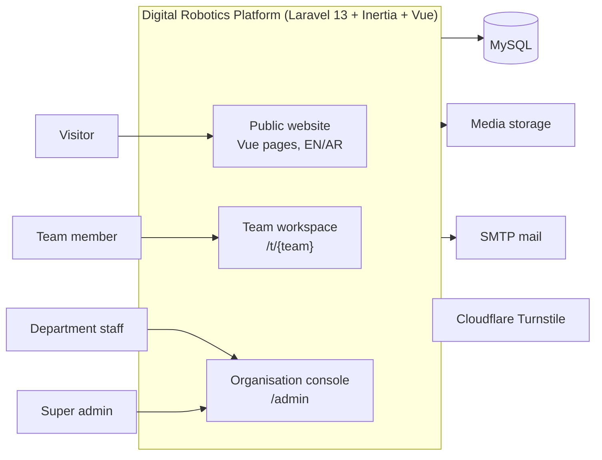

# Digital Robotics Platform v2 — Software Requirements Specification

IEEE Std 830-1998 structure · Version 0.2 (draft for review) · 2026-11-06 · Owner: T.N

> Status: **draft for approval.** No code is written until this document is approved. Items marked **[Open]** need a decision (Appendix C).

## 1. Introduction

### 1.1 Purpose
This SRS specifies the second-generation Digital Robotics Platform. The new platform puts **teams** at the centre. The foundation runs it through **departments**, and it feeds the **public website**. The document is the contract for design, build and acceptance. It replaces the baseline in `docs/SRS.md` (v1, current system).

### 1.2 Scope
The product is one web application with three connected parts:

| Part                            | Audience                                           | Purpose                                                                                                                                 |
| ------------------------------- | -------------------------------------------------- | --------------------------------------------------------------------------------------------------------------------------------------- |
| Organisation console (`/admin`) | Super admin, department admins, department members | Run the foundation: departments, teams and tiers, events, the shared parts catalogue, finance and sponsorships, content, inbox, reports |
| Team workspace (`/t/{team}`)    | Team members (captain, coach, member, viewer)      | Run a team: members, projects, robots and their parts, catalogue access, event entries                                                  |
| Public website (`/en`, `/ar`)   | Anyone                                             | Present the foundation, its public teams, projects, robots, events with results, and news; take contact messages                        |

**Out of scope for v2:** processing real payments (the platform records money; it does not transfer it), online card payments, a native mobile app, a public API, server-side rendering, multi-organisation tenancy, and learning-course management (the old teachers/classes module is retired).

### 1.3 Definitions, acronyms and abbreviations

| Term                  | Meaning                                                                                                                                          |
| --------------------- | ------------------------------------------------------------------------------------------------------------------------------------------------ |
| Organisation          | Digital Robotics Foundation Libya, the single operator of the platform                                                                           |
| Super admin           | Platform owner account with every permission, including reserved ones                                                                            |
| Department            | A unit of the organisation (e.g. Events, Procurement, Media) with its own admin and members                                                      |
| Department admin      | The manager of a department; manages its members and approves within its areas                                                                   |
| Permission ceiling    | The set of permissions the super admin allows a department to use and delegate                                                                   |
| Reserved permission   | A permission only the super admin holds; it can never be delegated                                                                               |
| Workspace             | The shared scope key for a team or a department; roles and permissions are assigned per workspace                                                |
| Team                  | A robotics team; the central entity of the platform                                                                                              |
| Tier                  | A named bundle of default team features (e.g. Starter, Competition)                                                                              |
| Feature / capability  | A team-level privilege (e.g. `parts.access`), resolved from the tier plus per-team overrides                                                     |
| Team role             | Captain, Coach, Member or Viewer within one team                                                                                                 |
| Member without login  | A person recorded on a team with no account (e.g. a young student)                                                                               |
| Project               | Team work with a story, optionally published                                                                                                     |
| Robot                 | A machine built by a team, optionally part of a project, with a bill of materials                                                                |
| BOM                   | Bill of materials: catalogue parts and quantities for a robot                                                                                    |
| Part / vendor / offer | A catalogue item / a seller / a seller's price and link for a part                                                                               |
| Event / category      | A competition or gathering run by a department / a competition class within it (e.g. Sumo)                                                       |
| Registration          | A team's entry in an event category, added by the organiser or applied for                                                                       |
| LYD                   | Libyan dinar (3 decimal places; 1 LYD = 1,000 dirhams)                                                                                           |
| Impersonation         | The super admin temporarily acting as another user to see and troubleshoot what they see                                                         |
| Account (finance)     | A balance holder in the ledger: general fund, earmarked fund, reinvestment pool, team budget, project budget, event budget, or an external party |
| Ledger transaction    | An immutable record moving an amount from one account to another; corrections are made with reversing transactions                               |
| Sponsor               | An organisation or person that gives money or goods; may have contacts without logins                                                            |
| Sponsorship           | An agreement with a sponsor: pledged value, period, purpose, restrictions and split rules                                                        |
| Receipt               | Money or goods actually received under a sponsorship (or as a donation, prize or other income)                                                   |
| Split rule            | How a receipt is divided between accounts (percentages or fixed amounts, with the remainder to a default account)                                |
| Funding request       | A team's request to move money from a fund into a project or team budget                                                                         |
| Payout                | A bonus, stipend, payment or reimbursement recorded for a person                                                                                 |
| Maker-checker         | A rule that the person who prepares a financial record cannot be the one who approves it                                                         |
| Inertia               | The library connecting Laravel controllers to Vue pages without a separate API                                                                   |
| FR / NFR              | Functional / non-functional requirement                                                                                                          |

### 1.4 References
- IEEE Std 830-1998, *Recommended Practice for Software Requirements Specifications*.
- `docs/SRS.md`, baseline SRS of the current system (v1).
- Approved implementation plan: team-centred platform rebuild (2026-11-06).
- Laravel 13, Inertia, Vue 3, spatie/laravel-permission v8 (teams), Laravel Pennant, spatie/laravel-honeypot, Cloudflare Turnstile, spatie/laravel-medialibrary, spatie/laravel-activitylog, spatie/laravel-backup, lab404/laravel-impersonate, brick/money.

### 1.5 Overview
- Section 2 describes the product context, users, constraints and assumptions.
- Section 3 lists the specific requirements: external interfaces (3.1), functional requirements per module (3.2 to 3.10), and non-functional requirements (3.11 to 3.13).
- Appendix A is the data model, Appendix B the permission catalogue, and Appendix C the open questions.

**Requirement IDs** follow `FR-<module>-<nn>`.

**Priorities:**
- **M** (must, needed for go-live);
- **S** (should, needed soon after);
- **C** (could, later).

**Phases** refer to the plan: 1 Foundation, 2 Console, 3 Workspace, 4 Public site, 5 Go-live.

## 2. Overall description

### 2.1 Product perspective
The platform is a new, self-contained Laravel 13 application. It replaces the current admin-only system, and no data is migrated. All three parts share one database, one permission system and one media store. The public website only reads published and public data.

**How the parts connect:**
1. A team builds projects and robots.
2. With the `projects.publish` or `public.profile` feature, the team marks them public.
3. They then appear on the public website.
4. Departments create events and news.
5. Approved registrations and results appear on the public event pages.
6. Sponsors' money enters the ledger, is split into funds, and is reinvested into team and project budgets; sponsors who agree are thanked on the public site.

### 2.2 Product functions (summary)

| Module                  | Summary                                                                                                                                             |
| ----------------------- | --------------------------------------------------------------------------------------------------------------------------------------------------- |
| Accounts and access     | Invitation-only accounts, login with 2FA, workspace hub, members without login                                                                      |
| Departments             | Create departments, set ceilings, appoint admins, delegate view/edit permissions to members                                                         |
| Teams and tiers         | Create and approve teams, assign tiers and overrides, supervising department, suspend                                                               |
| Team workspace          | Dashboard, members and roles, projects, robots with BOM and cost, settings and public profile                                                       |
| Catalogue               | Shared parts, categories, vendors, offers with prices; team suggestions with approval                                                               |
| Events                  | Configure events and categories, lifecycle, organiser-added teams, applications and approval, rules, results                                        |
| Content and inbox       | News posts, featured team work, contact messages routed to a department                                                                             |
| Finance and sponsorship | Sponsors and sponsorships, receipts with split rules, funds and budgets, funding requests and reinvestment, expenses, payouts to people, statements |
| Reports and audit       | Department dashboards, activity log, exports                                                                                                        |
| Public website          | Bilingual pages for teams, projects, robots, events with results, news, contact; SEO metadata; sitemap                                              |

### 2.3 User classes and characteristics

| User class           | Workspace                 | Characteristics and rights                                                                                                                               |
| -------------------- | ------------------------- | -------------------------------------------------------------------------------------------------------------------------------------------------------- |
| Visitor              | None                      | Anonymous; reads the public site in Arabic or English, often on mobile; can send contact messages                                                        |
| Super admin          | Global                    | 1–2 people; all permissions, including reserved ones; creates departments and tiers; system settings and backups                                         |
| Department admin     | Department                | Manages one department: adds and removes members, grants them permissions within the ceiling, approves items in the department's areas, sees its reports |
| Department member    | Department                | Staff with only the view/edit permissions the department admin granted                                                                                   |
| Finance staff        | Department (e.g. Finance) | Department members holding `finance.*` permissions; record sponsors, receipts, expenses and payouts; approval needs a second person                      |
| Payee                | Any user                  | A user who receives bonuses or payments; sees only their own payouts under "My earnings"                                                                 |
| Sponsor contact      | None (record)             | Contact person of a sponsor; no login in v2                                                                                                              |
| Team captain         | Team                      | Leads a team; everything inside the team within its features                                                                                             |
| Team coach           | Team                      | Like captain, except deleting the team or transferring captaincy                                                                                         |
| Team member          | Team                      | Works on projects and robots; reads the catalogue and events                                                                                             |
| Team viewer          | Team                      | Read-only access to the team workspace                                                                                                                   |
| Member without login | Team (record)             | Appears in rosters and event snapshots; cannot sign in                                                                                                   |

One user can hold several memberships, for example coach of two teams and a member of the Events department.

### 2.4 General constraints
- **Stack:** Laravel 13, PHP 8.5, MySQL 8; Inertia with Vue 3 + TypeScript, Tailwind CSS 4, shadcn-vue. Pest for tests.
- **No Blade pages** except the single Inertia root template.
- **Shared hosting:** no long-running Node or queue daemons.
  - Assets are built before deployment.
  - The queue and scheduler run from one cron entry.
  - There is **no SSR**.
- **Two locales:** English (LTR) and Arabic (RTL). Every user-facing text is translatable.
- **Approved packages:** spatie/laravel-permission (teams mode), spatie/laravel-honeypot, njoguamos/laravel-turnstile, laravel/pennant, spatie/laravel-medialibrary, spatie/laravel-activitylog, spatie/laravel-backup, lab404/laravel-impersonate, brick/money, laravel-vue-i18n (npm).

### 2.5 Assumptions and dependencies
- The hosting provider offers PHP 8.5 with the extensions intl, gd or imagick, exif, zip and pdo_mysql, plus cron and SMTP. **[Open: confirm with the host]**
- Cloudflare Turnstile site and secret keys are available for the production domain.
- One organisation operates the platform; departments are created by the super admin.
- Content is entered in English and optionally Arabic; English is the fallback.

## 3. Specific requirements

### 3.1 External interface requirements

**3.1.1 User interfaces**

| ID    | Requirement                                                                                                                                                                       | Pri |
| ----- | --------------------------------------------------------------------------------------------------------------------------------------------------------------------------------- | --- |
| UI-01 | All pages shall be Vue components rendered through Inertia; the root template shall set `<html lang dir>` from the active locale.                                                 | M   |
| UI-02 | The public site shall keep the approved v1 redesign: light warm palette, single orange accent, Manrope and Noto Kufi Arabic, card layouts, responsive from 375 px.                | M   |
| UI-03 | The console and the workspace shall share one application shell: sidebar navigation for the current workspace, a workspace switcher, user menu, language switch, light/dark mode. | M   |
| UI-04 | Lists shall use one data-table component with search, sort, filters and pagination that keep state in the URL.                                                                    | M   |
| UI-05 | Actions shall give feedback through toasts; form errors shall show inline under the field and link to it with `aria-describedby`.                                                 | M   |
| UI-06 | Actions the user is not permitted to do shall be hidden or disabled. The server shall still enforce every rule (FR-ACC-08).                                                       | M   |
| UI-07 | Error pages (403, 404, 419, 429, 500, 503) shall be localised Vue pages without exception details.                                                                                | M   |
| UI-08 | All screens shall work in RTL using logical CSS properties; icons with a direction shall mirror in Arabic.                                                                        | M   |

**3.1.2 Software interfaces**

| ID    | Interface                                                     | Use                                                                                      | Pri |
| ----- | ------------------------------------------------------------- | ---------------------------------------------------------------------------------------- | --- |
| SI-01 | MySQL 8                                                       | All data, sessions, cache, queue jobs, Pennant feature values                            | M   |
| SI-02 | Media disk (`public` or `public/media`)                       | Images, galleries, datasheets and generated thumbnails                                   | M   |
| SI-03 | SMTP                                                          | Invitations, password reset, 2FA recovery, registration status and contact notifications | M   |
| SI-04 | Cloudflare Turnstile API                                      | Server-side verification of captcha tokens                                               | M   |
| SI-05 | Google Fonts                                                  | Manrope and Noto Kufi Arabic                                                             | S   |
| SI-06 | Backup destination (local disk, plus an optional remote disk) | Scheduled database and media backups                                                     | M   |

**3.1.3 Hardware interfaces** — none.

**3.1.4 Communications interfaces**

| ID    | Requirement                                                                                                                                                                    | Pri |
| ----- | ------------------------------------------------------------------------------------------------------------------------------------------------------------------------------ | --- |
| CI-01 | The system shall be served over HTTPS in production.                                                                                                                           | M   |
| CI-02 | `GET /sitemap.xml` shall list public pages in both locales: teams, projects, robots, events and news.                                                                          | M   |
| CI-03 | `GET /up` shall return the health check.                                                                                                                                       | M   |
| CI-04 | The first HTML response of every public page shall contain its title, meta description, canonical URL, `hreflang` (en, ar, x-default) and Open Graph tags, without JavaScript. | M   |

### 3.2 Accounts and access (FR-ACC) — phase 1

| ID        | Requirement                                                                                                                                                                                         | Pri |
| --------- | --------------------------------------------------------------------------------------------------------------------------------------------------------------------------------------------------- | --- |
| FR-ACC-01 | Self-registration shall be disabled. Accounts are created only by accepting an invitation, or by the super admin.                                                                                   | M   |
| FR-ACC-02 | An invitation shall target a workspace (a team or a department), an e-mail address and a role. It shall expire after 7 days **[Open: duration]**. Anyone allowed to invite can resend or revoke it. | M   |
| FR-ACC-03 | Accepting an invitation shall create the account (name EN/AR, password) or, for an existing account, add the membership. Each invitation token can be used once.                                    | M   |
| FR-ACC-04 | Users shall sign in with e-mail and password. Two-factor authentication (TOTP with recovery codes) shall be available to all users as an option. It is not mandatory for any role.         | M   |
| FR-ACC-05 | Users shall reset a forgotten password by an e-mailed link and change their password from their profile.                                                                                            | M   |
| FR-ACC-06 | After login a user shall land on a hub listing their teams and departments, or go straight to the only one. The super admin lands on the console.                                                   | M   |
| FR-ACC-07 | The active workspace shall come from the URL. A user who is not a member of that workspace shall get 404 (team) or 403 (department).                                                                | M   |
| FR-ACC-08 | Every request shall be authorised on the server with policies that combine the workspace role or permissions and, for teams, the team's features.                                                   | M   |
| FR-ACC-09 | A user shall edit their own profile: name EN/AR, e-mail, phone, birthdate, photo, preferred language.                                                                                               | M   |
| FR-ACC-10 | A user shall switch the interface language. The choice shall be stored on the user and in a cookie.                                                                                                 | M   |
| FR-ACC-11 | The super admin shall be able to deactivate any account. A deactivated user cannot sign in, but their history is kept.                                                                              | S   |
| FR-ACC-12 | Holders of `users.impersonate` (the super admin) shall impersonate any active user except another super admin, from that user's page, to see the platform as they do.                               | M   |
| FR-ACC-13 | While impersonating, a persistent banner shall show "Acting as {name}" with a "Leave" action that returns to the original account.                                                                  | M   |
| FR-ACC-14 | While impersonating, the following shall be blocked: changing password, e-mail or 2FA; approving or posting finance records; granting permissions; and starting another impersonation.              | M   |
| FR-ACC-15 | Every impersonation start and end shall be written to the activity log with both users, IP address and duration. Actions taken while impersonating shall record the real causer.                    | M   |

### 3.3 Departments and delegation (FR-DEP) — phase 2

| ID        | Requirement                                                                                                                                                                                            | Pri |
| --------- | ------------------------------------------------------------------------------------------------------------------------------------------------------------------------------------------------------ | --- |
| FR-DEP-01 | The super admin shall create, edit and archive departments: name EN/AR, slug, description, public flag.                                                                                                | M   |
| FR-DEP-02 | The super admin shall set each department's **permission ceiling** by choosing permissions from the catalogue (Appendix B).                                                                            | M   |
| FR-DEP-03 | The super admin shall appoint one or more department admins by inviting them or choosing existing users.                                                                                               | M   |
| FR-DEP-04 | A department admin shall add members by invitation and remove them. Removing a member shall revoke all their department permissions.                                                                   | M   |
| FR-DEP-05 | A department admin shall grant or revoke individual permissions (`<area>.view`, `<area>.edit`) for each member, **only within the ceiling**. Any other permission shall be refused.                    | M   |
| FR-DEP-06 | **Reserved** permissions (`departments.manage`, `tiers.manage`, `settings.manage`, `backups.run`, `users.impersonate`) shall never appear in a ceiling and can never be granted by a department admin. | M   |
| FR-DEP-07 | `<area>.approve` permissions shall belong only to department admins. A department admin cannot grant them to members.                                                                                  | M   |
| FR-DEP-08 | Lowering a ceiling shall revoke, immediately, any member permissions that fall outside it.                                                                                                             | M   |
| FR-DEP-09 | A department member shall see only the console areas they have permissions for. Within an area, `view` allows reading and `edit` allows create, update and delete.                                     | M   |
| FR-DEP-10 | Records that belong to a department (events, posts, inbox messages) shall be visible only to that department's staff and the super admin.                                                              | M   |
| FR-DEP-11 | A department may supervise teams. Its staff with `teams.view` see only supervised teams, unless the ceiling includes `teams.view.all`.                                                                 | S   |
| FR-DEP-12 | Every permission change shall be written to the activity log: who, whom, what, when.                                                                                                                   | M   |

### 3.4 Teams, tiers and features (FR-TEAM) — phases 2–3

| ID         | Requirement                                                                                                                                               | Pri |
| ---------- | --------------------------------------------------------------------------------------------------------------------------------------------------------- | --- |
| FR-TEAM-01 | Staff with `teams.edit` shall create a team: name, slug (auto, unique), tier, supervising department, location. They shall then invite its first captain. | M   |
| FR-TEAM-02 | A team shall have a status: pending, active or suspended. Only active teams can use features. Suspended teams are read-only and hidden publicly.          | M   |
| FR-TEAM-03 | Staff with `teams.approve` (department admins) shall approve pending teams and suspend or restore teams, with a reason.                                   | M   |
| FR-TEAM-04 | The super admin shall manage tiers: name, slug and a default value for every feature (Appendix B.2).                                                      | M   |
| FR-TEAM-05 | Staff with `teams.edit` shall set per-team overrides for any feature, on top of the tier. The effective value shall be shown next to the tier value.      | M   |
| FR-TEAM-06 | Feature checks shall use the effective value: override, else tier default. Changes shall apply on the next request.                                       | M   |
| FR-TEAM-07 | Teams cannot be hard-deleted while they have registrations. Archiving keeps history.                                                                      | M   |
| FR-TEAM-08 | Staff with `teams.view` shall see each team's members, projects, robots, registrations and activity, read-only.                                           | M   |

### 3.5 Team workspace (FR-WS) — phase 3

| ID       | Requirement                                                                                                                                                                                     | Pri |
| -------- | ----------------------------------------------------------------------------------------------------------------------------------------------------------------------------------------------- | --- |
| FR-WS-01 | The team dashboard shall show: members used against `members.max`, projects by status, robots by status, total BOM cost, upcoming registrations and their status, and recent activity.          | M   |
| FR-WS-02 | Captains and coaches shall invite members with a role, add members without login (name, birthdate, optional photo), change roles and remove members. There shall always be exactly one captain. | M   |
| FR-WS-03 | Adding a member beyond the `members.max` limit shall be refused with a clear message.                                                                                                           | M   |
| FR-WS-04 | The captain shall transfer captaincy to another member with a login. Any member can leave a team, except the captain.                                                                           | M   |
| FR-WS-05 | With `projects.create`, members shall create and edit projects: title, excerpt and body EN/AR, cover image, gallery, and linked robots.                                                         | M   |
| FR-WS-06 | With `projects.publish`, captains and coaches shall publish or unpublish a project. A published project appears on the public site.                                                             | M   |
| FR-WS-07 | With `robots.create`, members shall create and edit robots: name, description, status (design/building/ready/retired), photos, project link, public flag.                                       | M   |
| FR-WS-08 | A robot's BOM shall list catalogue parts with quantity, chosen vendor offer and notes. It shall show line totals, a robot total in LYD, and a "shopping list" grouped by vendor.                | M   |
| FR-WS-09 | A BOM line whose part is later archived or whose offer is removed shall remain, flagged "unavailable".                                                                                          | S   |
| FR-WS-10 | Captains and coaches shall edit the team's settings: logo and public profile (description EN/AR, location, focus, website). With `public.profile`, they can also make the team public.          | M   |
| FR-WS-11 | Viewers shall have read-only access to every workspace page.                                                                                                                                    | M   |

### 3.6 Shared catalogue (FR-CAT) — phases 2–3

| ID        | Requirement                                                                                                                                                                                           | Pri |
| --------- | ----------------------------------------------------------------------------------------------------------------------------------------------------------------------------------------------------- | --- |
| FR-CAT-01 | Staff with `catalogue.edit` shall manage part categories, parts (name, part number, category, description, image, datasheet, specifications) and vendors (name, website, contacts, city or location). | M   |
| FR-CAT-02 | A part shall have any number of vendor offers: vendor, price (minor units), currency (LYD default), product link, in-stock flag, last-checked date.                                                   | M   |
| FR-CAT-03 | With `parts.access`, team members shall search and filter parts by name, part number, category, vendor and price range. They shall compare offers and add a part to a robot's BOM.                    | M   |
| FR-CAT-04 | With `parts.suggest`, team members shall suggest a new part, vendor or offer. A suggestion is "suggested", visible only to that team and to catalogue staff.                                          | M   |
| FR-CAT-05 | Staff with `catalogue.approve` shall approve (optionally after editing), reject with a reason, or merge a suggestion into an existing item. The suggesting team shall be notified.                    | M   |
| FR-CAT-06 | Parts used in a BOM cannot be deleted, only archived.                                                                                                                                                 | M   |
| FR-CAT-07 | Prices shall be stored as integers in minor units. LYD shall be shown with 3 decimals.                                                                                                                | M   |

### 3.7 Events (FR-EVT) — phases 2–4

| ID        | Requirement                                                                                                                                                                                                                                                                                                                                                                 | Pri |
| --------- | --------------------------------------------------------------------------------------------------------------------------------------------------------------------------------------------------------------------------------------------------------------------------------------------------------------------------------------------------------------------------- | --- |
| FR-EVT-01 | Staff with `events.edit` in the owning department shall create an event: title and description EN/AR, slug, venue, start and end, registration opening and closing, visibility (public/invite-only), capacity (maximum teams), banner, gallery, rules and terms.                                                                                                            | M   |
| FR-EVT-02 | An event shall have one or more categories, each with: name EN/AR, minimum and maximum age, minimum and maximum members, robots per team, and robot constraints (e.g. maximum weight in kg, maximum size in cm).                                                                                                                                                            | M   |
| FR-EVT-03 | An event shall move through draft → open → closed → running → finished → archived. Only open events accept applications. Only finished events can publish results.                                                                                                                                                                                                          | M   |
| FR-EVT-04 | Organiser staff shall **add a team directly** to a category, choosing the team, its robot(s) and members. Optionally they send it as an invitation the team must accept.                                                                                                                                                                                                    | M   |
| FR-EVT-05 | With `events.register`, a team's captain or coach shall apply to an open public event, or to an invite-only event they were invited to. They choose a category, robot(s) and members.                                                                                                                                                                                       | M   |
| FR-EVT-06 | Entry rules shall be checked on add, apply and approve: the team is active; the members' ages on the event start date are within the category limits; the member count is within limits; the robot count is within the category limit; the team has at most one registration per category; registration is within its window (applications only); capacity is not exceeded. | M   |
| FR-EVT-07 | Department admins shall be able to override a failed rule when adding or approving, with a required reason that is recorded.                                                                                                                                                                                                                                                | S   |
| FR-EVT-08 | A registration shall have a status: invited, pending, approved, rejected, waitlisted or withdrawn. Approved registrations count against capacity. When capacity is full, new approvals go to the waitlist.                                                                                                                                                                  | M   |
| FR-EVT-09 | Staff with `events.approve` shall approve, reject (with a reason) or waitlist applications, and promote from the waitlist when a place frees up.                                                                                                                                                                                                                            | M   |
| FR-EVT-10 | Team members shall be snapshotted on approval: name, age at event start, role. Later roster changes do not alter the registration.                                                                                                                                                                                                                                          | M   |
| FR-EVT-11 | A team shall withdraw its own registration before registration closes.                                                                                                                                                                                                                                                                                                      | M   |
| FR-EVT-12 | Status changes shall notify the team's captain and coaches by e-mail and in the workspace.                                                                                                                                                                                                                                                                                  | S   |
| FR-EVT-13 | Organiser staff shall record results per category (placement, score, notes) and publish them.                                                                                                                                                                                                                                                                               | S   |
| FR-EVT-14 | Organiser staff shall export the participant list of an event or category.                                                                                                                                                                                                                                                                                                  | S   |
| FR-EVT-15 | Invite-only events shall be invisible to teams that were not invited and on the public site until results are published **[Open]**.                                                                                                                                                                                                                                         | M   |

### 3.8 Content, inbox and reports (FR-CON) — phase 2

| ID        | Requirement                                                                                                                                                                                           | Pri |
| --------- | ----------------------------------------------------------------------------------------------------------------------------------------------------------------------------------------------------- | --- |
| FR-CON-01 | Staff with `content.edit` shall write news posts: title, excerpt and body EN/AR, cover image, publish date. Each post can be scheduled.                                                               | M   |
| FR-CON-02 | Staff with `content.approve` shall publish posts. Every published post appears on the public news pages.                                                                                              | M   |
| FR-CON-03 | Staff with `content.edit` shall feature published team projects and robots on the public home page.                                                                                                   | S   |
| FR-CON-04 | Contact messages shall be routed to a configurable department inbox. Staff with `inbox.view` see them; staff with `inbox.edit` change their status (new, in progress, closed) and add internal notes. | M   |
| FR-CON-05 | New contact messages shall e-mail the inbox department's admins.                                                                                                                                      | S   |
| FR-CON-06 | Department admins shall see a department report: their department's counts (e.g. registrations by status, suggestions pending, messages open) and its activity log, with date filters.                | M   |
| FR-CON-07 | Reports and lists with `reports.view` shall be exportable to CSV **[Open: spatie/simple-excel]**.                                                                                                     | C   |
| FR-CON-08 | The super admin shall see the full activity log across the platform and filter it by user, workspace, subject and date.                                                                               | M   |

### 3.9 Finance and sponsorship (FR-FIN) — phases 2–3

The finance module is a small ledger. Every movement of money is one immutable transaction from one account to another, so every balance, budget and statement can be traced to its source. The platform records money; it does not move real money.

**3.9.1 Accounts and ledger**

| ID        | Requirement                                                                                                                                                                                                                                                                       | Pri |
| --------- | --------------------------------------------------------------------------------------------------------------------------------------------------------------------------------------------------------------------------------------------------------------------------------- | --- |
| FR-FIN-01 | The system shall keep accounts of these types: general fund, earmarked fund (restricted to a purpose), reinvestment pool, team budget, project budget, event budget, and external party (sponsor, vendor, person). Team and project budget accounts are created on demand.        | M   |
| FR-FIN-02 | Every money movement shall be a ledger transaction: date, from-account, to-account, amount, currency, exchange rate to LYD, type, description, reference (receipt or invoice number), attachment, linked record (sponsorship, request, expense, payout), created by, approved by. | M   |
| FR-FIN-03 | Posted transactions shall be immutable. A correction shall be a reversing transaction linked to the original, with a reason.                                                                                                                                                      | M   |
| FR-FIN-04 | An account's balance shall be the sum of its incoming minus outgoing posted transactions, shown in its own currency and in LYD.                                                                                                                                                   | M   |
| FR-FIN-05 | Amounts shall be stored as integers in minor units with their ISO currency, and calculated with brick/money (no floating point). LYD shows 3 decimals; other currencies use their ISO precision.                                                                                  | M   |
| FR-FIN-06 | Non-LYD transactions shall store the exchange rate used on the transaction date. Reports in LYD use that stored rate.                                                                                                                                                             | M   |
| FR-FIN-07 | Transactions shall go draft → submitted → approved/posted, or rejected. Only posted transactions affect balances.                                                                                                                                                                 | M   |
| FR-FIN-08 | **Maker-checker:** the user who created or submitted a transaction cannot approve it. Approval needs `finance.approve`.                                                                                                                                                           | M   |
| FR-FIN-09 | Outgoing transactions that would make a fund or budget negative shall be refused, unless a department admin overrides with a reason.                                                                                                                                              | M   |
| FR-FIN-10 | Each fiscal period (month) can be closed by a finance admin. Closed periods accept no new transactions dated inside them; corrections go into the open period.                                                                                                                    | S   |

**3.9.2 Sponsors, sponsorships and receipts**

| ID        | Requirement                                                                                                                                                                                                                                                                     | Pri |
| --------- | ------------------------------------------------------------------------------------------------------------------------------------------------------------------------------------------------------------------------------------------------------------------------------- | --- |
| FR-FIN-11 | Finance staff shall manage sponsors: name EN/AR, type (company, organisation, individual, government), logo, website, contacts (name, role, phone, e-mail), notes, public-acknowledgement consent.                                                                              | M   |
| FR-FIN-12 | Finance staff shall record sponsorships per sponsor: title, pledged value and currency, kind (cash, in-kind, mixed), start and end dates, purpose and restrictions, linked team, event or project (optional), agreement document, status (draft, active, completed, cancelled). | M   |
| FR-FIN-13 | Each sponsorship shall have split rules: lines of target account and either a percentage or a fixed amount, applied in order, with the remainder going to a default account (general fund unless set). Percentages cannot exceed 100%.                                          | M   |
| FR-FIN-14 | Recording a receipt (date, amount, currency, method: bank, cash, cheque, in-kind; reference; attachment) under a sponsorship shall propose the split transactions from its rules. Finance staff can adjust them before submitting.                                              | M   |
| FR-FIN-15 | In-kind receipts shall record the items and their estimated value, optionally linked to catalogue parts. They are valued in the ledger at the estimated value.                                                                                                                  | S   |
| FR-FIN-16 | The sponsorship page shall show pledged against received, the outstanding amount, how the money was split, and where it was spent (traced through the target accounts).                                                                                                         | M   |
| FR-FIN-17 | Other income (donations, prize money, event fees, grants) shall be recorded as receipts without a sponsorship, with an optional split.                                                                                                                                          | M   |
| FR-FIN-18 | Finance staff shall produce a sponsor statement (PDF or print view) for a period: receipts, splits, and the projects and teams funded.                                                                                                                                          | S   |

**3.9.3 Budgets, reinvestment and expenses**

| ID        | Requirement                                                                                                                                                                                                                                         | Pri |
| --------- | --------------------------------------------------------------------------------------------------------------------------------------------------------------------------------------------------------------------------------------------------- | --- |
| FR-FIN-19 | With the `budget.request` team feature, a captain or coach shall submit a funding request for a project or for the team: amount, purpose, cost breakdown (optionally imported from robot BOMs), and the requested source fund.                      | M   |
| FR-FIN-20 | Staff with `finance.approve` shall approve (fully or partly), reject with a reason, or ask for changes. Approval posts a transfer from the chosen fund into the project or team budget account.                                                     | M   |
| FR-FIN-21 | Finance staff shall allocate money from any fund to team, project or event budgets without a request (reinvestment), with a purpose.                                                                                                                | M   |
| FR-FIN-22 | Expenses shall be recorded against a budget: date, vendor (from the catalogue or free text), items, amount, receipt attachment, optional link to BOM lines. Team captains or coaches submit expenses for their budgets; finance staff approve them. | M   |
| FR-FIN-23 | A project or team shall show budget against spent and remaining, with its funding sources (which sponsor or fund paid for it).                                                                                                                      | M   |
| FR-FIN-24 | Unspent budget can be returned to its source fund or the reinvestment pool when a project closes.                                                                                                                                                   | S   |
| FR-FIN-25 | Income produced by a project or team (e.g. prize money) can be credited to the reinvestment pool or back to that team's budget, according to a configurable default.                                                                                | S   |

**3.9.4 Payouts to people**

| ID        | Requirement                                                                                                                                                                                                                                                                                                     | Pri |
| --------- | --------------------------------------------------------------------------------------------------------------------------------------------------------------------------------------------------------------------------------------------------------------------------------------------------------------- | --- |
| FR-FIN-26 | Finance staff shall record payouts to a user (or to a member without login through a guardian name): type (bonus, stipend, payment for work, prize share, reimbursement), amount, currency, source account, reason, optional link (event result, project, expense), payment method and reference, payment date. | M   |
| FR-FIN-27 | Payouts follow draft → submitted → approved → paid, with maker-checker (FR-FIN-08). "Paid" requires a payment reference or proof.                                                                                                                                                                               | M   |
| FR-FIN-28 | Bonus rules can be defined: e.g. a fixed amount per placement in an event category, split among the registration's members. Applying a rule generates draft payouts for review.                                                                                                                                 | C   |
| FR-FIN-29 | Every user shall see their own payouts under "My earnings": status, amounts, totals per year. They cannot see other users' payouts.                                                                                                                                                                             | M   |
| FR-FIN-30 | Payouts to members under 18 shall require a guardian name and contact recorded on the payout.                                                                                                                                                                                                                   | S   |

**3.9.5 Finance reports and transparency**

| ID        | Requirement                                                                                                                                                                                                                                | Pri |
| --------- | ------------------------------------------------------------------------------------------------------------------------------------------------------------------------------------------------------------------------------------------ | --- |
| FR-FIN-31 | The finance dashboard shall show: balances per fund and budget, income and spending this period, outstanding pledges, pending approvals, and the top sponsors and projects funded.                                                         | M   |
| FR-FIN-32 | Reports shall cover: income by sponsor or source, spending by team, project or category, payouts by person and type, fund movements (statement per account), and budget against actual. Each can be filtered by period and exported (CSV). | M   |
| FR-FIN-33 | With a sponsor's consent, the public site shall list the sponsor (logo, name, link), optionally with the teams, events or projects they supported. Amounts are never public.                                                               | S   |
| FR-FIN-34 | Team captains and coaches shall see their own team's and projects' budgets, funding sources and expenses, but no other team's finances or any payouts.                                                                                     | M   |

### 3.10 Public website (FR-PUB) — phase 4

| ID        | Requirement                                                                                                                                                                                                                      | Pri |
| --------- | -------------------------------------------------------------------------------------------------------------------------------------------------------------------------------------------------------------------------------- | --- |
| FR-PUB-01 | The public site shall be served under `/en` and `/ar`. `/` shall redirect to the visitor's last locale or English. An invalid locale returns 404.                                                                                | M   |
| FR-PUB-02 | Every public query shall use the model's public scope: active and public teams; published projects of public teams; public robots of public teams; public events not in draft; published posts. Nothing else shall be reachable. | M   |
| FR-PUB-03 | Home shall show the hero, the foundation introduction, featured teams, projects and robots, upcoming events and the latest news. Each block shall have an empty state.                                                           | M   |
| FR-PUB-04 | About shall present the foundation and the departments that are marked public.                                                                                                                                                   | M   |
| FR-PUB-05 | The teams directory shall list public teams (search, location filter). A team page shall show its profile, published projects, public robots, and event history with results. Rosters are never shown.                           | M   |
| FR-PUB-06 | A project page shall show the project's content, gallery, team and linked public robots. A robot page shall show the robot's photos, status and team; the BOM is not shown **[Open]**.                                           | M   |
| FR-PUB-07 | The events list shall show public events (upcoming, in progress, past). An event page shall show categories with rules, dates, venue, approved teams per category, and published results.                                        | M   |
| FR-PUB-08 | An event page "Apply" action shall send signed-in captains or coaches to their workspace application form, and visitors to login or contact.                                                                                     | M   |
| FR-PUB-09 | News list and article pages shall show published posts.                                                                                                                                                                          | M   |
| FR-PUB-10 | The contact form shall take name, e-mail, subject, message and privacy consent. It is protected by honeypot, Turnstile and throttling (NFR-SEC-04).                                                                              | M   |
| FR-PUB-11 | FAQ and privacy pages shall be editable by staff with `content.edit` **[Open: static vs editable]**.                                                                                                                             | S   |
| FR-PUB-12 | Every public page shall provide localised meta tags per CI-04, and the sitemap per CI-02.                                                                                                                                        | M   |
| FR-PUB-13 | Public text shall show in the visitor's locale and fall back to English when the Arabic text is missing.                                                                                                                         | M   |

### 3.11 Performance requirements

| ID          | Requirement                                                                                                                         | Pri |
| ----------- | ----------------------------------------------------------------------------------------------------------------------------------- | --- |
| NFR-PERF-01 | Public pages shall return their first HTML in under 500 ms (server time, p95) on the target host, with at most 15 database queries. | M   |
| NFR-PERF-02 | Lists shall be paginated on the server (default 15 rows) with eager loading; no N+1 queries.                                        | M   |
| NFR-PERF-03 | Images shall be served as resized conversions (thumbnail, card, large) in WebP, and lazy-loaded below the fold.                     | M   |
| NFR-PERF-04 | Public JavaScript shall be split per page. The public entry bundle shall stay under 150 kB gzip.                                    | S   |
| NFR-PERF-05 | The system shall handle 200 teams, 5,000 users, 2,000 parts and 50 concurrent users without degradation.                            | S   |

### 3.12 Design constraints

| ID        | Requirement                                                                                                                                      |
| --------- | ------------------------------------------------------------------------------------------------------------------------------------------------ |
| NFR-DC-01 | Laravel conventions: Form Requests, Eloquent relations, policies, service classes for multi-step rules, API Resources for Inertia props.         |
| NFR-DC-02 | spatie/laravel-permission in teams mode, keyed on `workspaces.id`. `super-admin` is a global role, with `Gate::before`.                          |
| NFR-DC-03 | Laravel Pennant is used for team features, scoped to `Team`, with the tier as the default resolver.                                              |
| NFR-DC-04 | Multi-step writes (registrations, approvals, delegation, captain transfer) run in transactions with row locks where races are possible.          |
| NFR-DC-05 | No SSR and no Node at runtime. One cron entry runs the scheduler, which runs the queue worker with `--stop-when-empty` and the backups.          |
| NFR-DC-06 | Pest tests accompany every feature; Pint for PHP style; ESLint, Prettier and `vue-tsc` for the front end.                                        |
| NFR-DC-07 | Impersonation uses lab404/laravel-impersonate, limited to `users.impersonate` through its `canImpersonate` and `canBeImpersonated` hooks.        |
| NFR-DC-08 | Money uses brick/money value objects and integer minor-unit columns; ledger writes go through one `LedgerService` inside a database transaction. |

### 3.13 Software system attributes

| ID           | Attribute       | Requirement                                                                                                                                                                                                                                    | Pri |
| ------------ | --------------- | ---------------------------------------------------------------------------------------------------------------------------------------------------------------------------------------------------------------------------------------------- | --- |
| NFR-SEC-01   | Security        | Every route except the public site and auth requires authentication. Authorisation is server-side on every request (FR-ACC-08).                                                                                                                | M   |
| NFR-SEC-02   | Security        | Workspace isolation: no data from one team or department is readable or writable from another, tested per module.                                                                                                                              | M   |
| NFR-SEC-03   | Security        | 2FA is optional for every user. Passwords are at least 10 characters and checked against breached-password lists.                                                                                                  | M   |
| NFR-SEC-04   | Spam protection | Honeypot (spatie, Inertia mode) on all public and auth forms. Turnstile on contact, login, password reset and invitation acceptance. Throttling: contact 3/min, auth 5/min, applications 10/min.                                               | M   |
| NFR-SEC-05   | Security        | Uploads are restricted by type and size (images 5 MB, datasheets 10 MB, PDF only) and stored with generated names.                                                                                                                             | M   |
| NFR-SEC-06   | Security        | CSRF protection, secure cookies and security headers (CSP, frame-ancestors, referrer-policy) in production.                                                                                                                                    | M   |
| NFR-AUD-01   | Audit           | Activity log entries for: auth events, membership and permission changes, team status, tier and feature changes, registrations and their status, catalogue approvals, publishing, impersonation, and every finance record change and approval. | M   |
| NFR-FIN-01   | Integrity       | Ledger balances shall always equal the sum of posted transactions. A nightly check shall flag any mismatch to the super admin.                                                                                                                 | M   |
| NFR-FIN-02   | Confidentiality | Finance data is visible only to `finance.*` holders, the super admin, and the scoped views in FR-FIN-29 and FR-FIN-34. Finance approvals require 2FA confirmation within the last 15 minutes.                                                  | M   |
| NFR-FIN-03   | Retention       | Finance records and attachments shall never be hard-deleted, and are kept at least 10 years **[Open: legal requirement]**.                                                                                                                     | M   |
| NFR-BAK-01   | Backup          | Daily database and media backup, kept 7 daily, 4 weekly and 3 monthly. The super admin is notified when a backup fails.                                                                                                                        | M   |
| NFR-L10N-01  | Localisation    | Every UI string goes through translations in `lang/en` and `lang/ar`. Content fields have EN/AR variants. Dates use the locale's month names; all numbers, amounts and dates use Western digits (0-9) in both languages.                                                                                          | M   |
| NFR-A11Y-01  | Accessibility   | WCAG 2.2 AA: keyboard navigation, visible focus, labelled controls, 4.5:1 contrast, reduced motion, skip link.                                                                                                                                 | M   |
| NFR-PRIV-01  | Privacy         | Minors' data (birthdate, photo) is visible only inside their team and to authorised staff, and never on public pages. Retention period: **[Open]**.                                                                                            | M   |
| NFR-MAINT-01 | Maintainability | Feature tests cover every FR marked M. CI runs PHP tests, front-end lint and type-check, and the build.                                                                                                                                        | M   |
| NFR-AVAIL-01 | Availability    | Health endpoint; maintenance mode during deploys; error logging with daily rotation.                                                                                                                                                           | M   |

## Appendix A. Data model

| Entity                      | Key fields                                                                                                                                                                             | Relations                                                                        |
| --------------------------- | -------------------------------------------------------------------------------------------------------------------------------------------------------------------------------------- | -------------------------------------------------------------------------------- |
| User                        | name_en, name_ar, email (nullable for members without login), password, phone, birthdate, locale, is_active, 2FA fields                                                                | Memberships in teams and departments; Spatie roles and permissions per workspace |
| Workspace                   | id, type (team / department)                                                                                                                                                           | Owned by one Team or one Department; the Spatie team key                         |
| Department                  | workspace_id, name en/ar, slug, description, is_public                                                                                                                                 | Members (is_admin flag), permission ceiling, events, posts, supervised teams     |
| DepartmentMember            | department_id, user_id, is_admin                                                                                                                                                       | User ↔ Department                                                                |
| DepartmentPermissionCeiling | department_id, permission_id                                                                                                                                                           | Department ↔ Permission                                                          |
| Tier                        | name, slug, feature defaults (JSON)                                                                                                                                                    | Teams                                                                            |
| Team                        | workspace_id, tier_id, department_id (supervisor), name, slug, status, description en/ar, location, focus, official_url, is_public                                                     | Members, projects, robots, registrations, suggestions; logo (media)              |
| TeamMember                  | team_id, user_id, joined_at                                                                                                                                                            | User ↔ Team; role = Spatie role in the team workspace                            |
| Invitation                  | workspace_id, email, role, token (hashed), invited_by, expires_at, accepted_at                                                                                                         | Workspace                                                                        |
| Project                     | team_id, slug, title/excerpt/body en/ar, status, published_at, is_featured                                                                                                             | Team; robots; cover and gallery (media)                                          |
| Robot                       | team_id, project_id, name, slug, description en/ar, status, is_public, is_featured                                                                                                     | Team, project; BOM lines; photos (media)                                         |
| RobotPart (BOM line)        | robot_id, part_id, quantity, vendor_offer_id, notes                                                                                                                                    | Robot, part, offer                                                               |
| PartCategory                | name en/ar, slug, parent_id                                                                                                                                                            | Parts                                                                            |
| Part                        | category_id, name, part_number, description, specs (JSON), status, suggested_by_team_id                                                                                                | Offers; image and datasheet (media)                                              |
| Vendor                      | name, website, email, phone, city, status, suggested_by_team_id                                                                                                                        | Offers                                                                           |
| VendorOffer                 | part_id, vendor_id, price_minor, currency, url, in_stock, checked_at, status                                                                                                           | Part, vendor                                                                     |
| Event                       | department_id, slug, title/description en/ar, venue, starts_at, ends_at, registration_opens_at, registration_closes_at, status, visibility, capacity, rules en/ar                      | Categories, registrations, invitations; banner and gallery (media)               |
| EventCategory               | event_id, name en/ar, age_min, age_max, members_min, members_max, robots_per_team, constraints (JSON)                                                                                  | Event, registrations                                                             |
| EventRegistration           | event_id, category_id, team_id, source, status, members_snapshot (JSON), override_reason, reviewed_by, reviewed_at, note                                                               | Robots (pivot), result                                                           |
| EventResult                 | registration_id, placement, score, notes, published_at                                                                                                                                 | Registration                                                                     |
| Post                        | department_id, slug, title/excerpt/body en/ar, status, published_at                                                                                                                    | Department; cover (media)                                                        |
| ContactMessage              | department_id, name, email, subject, message, locale, status, notes                                                                                                                    | Department                                                                       |
| Feature values (Pennant)    | feature name, scope (Team), value                                                                                                                                                      | Team                                                                             |
| Sponsor                     | name en/ar, type, website, notes, public_consent, is_active                                                                                                                            | Contacts, sponsorships; logo (media)                                             |
| SponsorContact              | sponsor_id, name, role, phone, email                                                                                                                                                   | Sponsor                                                                          |
| Sponsorship                 | sponsor_id, title, kind, pledged_minor, currency, starts_on, ends_on, purpose, restrictions, status, team_id / event_id / project_id (optional), default_account_id                    | Split rules, receipts; agreement (media)                                         |
| SplitRule                   | sponsorship_id, position, account_id, percent (nullable), fixed_minor (nullable)                                                                                                       | Sponsorship, account                                                             |
| Receipt                     | sponsorship_id (nullable), source_type, date, amount_minor, currency, rate_to_lyd, method, reference, in_kind_items (JSON)                                                             | Ledger transactions; proof (media)                                               |
| FinanceAccount              | type, owner (polymorphic: fund, team, project, event, sponsor, vendor, user), name, currency, is_restricted, purpose                                                                   | Ledger transactions                                                              |
| LedgerTransaction           | date, from_account_id, to_account_id, amount_minor, currency, rate_to_lyd, type, status, description, reference, source (polymorphic), created_by, approved_by, reverses_id, period_id | Accounts; attachment (media)                                                     |
| FiscalPeriod                | starts_on, ends_on, closed_at, closed_by                                                                                                                                               | Transactions                                                                     |
| FundingRequest              | team_id, project_id, amount_minor, currency, purpose, breakdown (JSON), source_account_id, status, reviewed_by, approved_minor                                                         | Transactions                                                                     |
| Expense                     | budget_account_id, vendor_id or vendor_name, date, amount_minor, currency, items (JSON), bom_line_ids, status                                                                          | Transaction; receipt (media)                                                     |
| Payout                      | user_id, guardian_name, guardian_contact, type, amount_minor, currency, source_account_id, reason, link (polymorphic), status, method, reference, paid_on, created_by, approved_by     | Transaction; proof (media)                                                       |
| BonusRule                   | event_category_id, placement, amount_minor, currency, split (equal / custom)                                                                                                           | Generates payouts                                                                |
| Activity (activitylog)      | causer, subject, event, properties, workspace_id                                                                                                                                       | All audited models                                                               |

## Appendix B. Permission catalogue

### B.1 Console permissions (department scope)

| Area                     | view                                                                                                                              | edit                                                                             | approve (admins only)                                                                   |
| ------------------------ | --------------------------------------------------------------------------------------------------------------------------------- | -------------------------------------------------------------------------------- | --------------------------------------------------------------------------------------- |
| teams                    | See teams (supervised, or all with `teams.view.all`)                                                                              | Create teams, edit profile, tier and overrides                                   | Approve, suspend, restore teams                                                         |
| events                   | See the department's events and registrations                                                                                     | Create and configure events, categories; add teams; record results               | Approve, reject, waitlist; publish results; rule overrides                              |
| catalogue                | See catalogue and suggestions                                                                                                     | Manage parts, vendors, offers, categories                                        | Approve, reject, merge suggestions                                                      |
| content                  | See posts                                                                                                                         | Write posts, feature team work                                                   | Publish posts                                                                           |
| inbox                    | Read messages                                                                                                                     | Change status, add notes                                                         | —                                                                                       |
| finance                  | See ledger, sponsors, budgets, reports                                                                                            | Record sponsors, sponsorships, receipts, expenses, payouts, allocations (drafts) | Approve and post transactions, requests, payouts; close periods (maker-checker applies) |
| reports                  | See department dashboards                                                                                                         | Export                                                                           | —                                                                                       |
| members (own department) | —                                                                                                                                 | —                                                                                | Department admins manage members and grants (FR-DEP-04/05)                              |
| **Reserved**             | `departments.manage`, `tiers.manage`, `settings.manage`, `backups.run`, `users.impersonate`: super admin only, never in a ceiling |                                                                                  |                                                                                         |

### B.2 Team features (Pennant, tier default + override)

| Feature          | Type   | Example: Starter | Example: Competition |
| ---------------- | ------ | ---------------- | -------------------- |
| members.max      | number | 8                | 20                   |
| projects.create  | on/off | on               | on                   |
| projects.publish | on/off | off              | on                   |
| robots.create    | on/off | on               | on                   |
| parts.access     | on/off | on               | on                   |
| parts.suggest    | on/off | off              | on                   |
| events.register  | on/off | off              | on                   |
| public.profile   | on/off | off              | on                   |
| budget.request   | on/off | off              | on                   |

### B.3 Team role matrix

| Action                                             | Captain | Coach | Member | Viewer |
| -------------------------------------------------- | ------- | ----- | ------ | ------ |
| View workspace                                     | ✓       | ✓     | ✓      | ✓      |
| Edit projects and robots, BOM                      | ✓       | ✓     | ✓      | —      |
| Publish projects, team settings                    | ✓       | ✓     | —      | —      |
| Invite, remove members, change roles               | ✓       | ✓     | —      | —      |
| Apply to events, withdraw                          | ✓       | ✓     | —      | —      |
| Suggest catalogue items                            | ✓       | ✓     | ✓      | —      |
| Request funding, submit expenses, view team budget | ✓       | ✓     | —      | —      |
| Transfer captaincy, archive team                   | ✓       | —     | —      | —      |

## Appendix C. Open questions

| #    | Question                                                                                                  | Default if not decided                                           |
| ---- | --------------------------------------------------------------------------------------------------------- | ---------------------------------------------------------------- |
| C-01 | Does the host provide PHP 8.5, cron and SMTP?                                                             | Must be confirmed before phase 5                                 |
| C-02 | Invitation expiry duration?                                                                               | 24 hours                                                           |
| C-03 | ~~Store EN/AR fields as separate columns or JSON?~~ Decided: separate `_en`/`_ar` columns | — |
| C-04 | ~~Multi-currency prices~~ Decided: brick/money with integer minor units; see C-12 for accepted currencies | —                                                                |
| C-05 | CSV/XLSX exports (`spatie/simple-excel`) in v2?                                                           | CSV in phase 2 if approved, otherwise later                      |
| C-06 | Should robot BOMs or cost ever be public?                                                                 | Never public                                                     |
| C-07 | Are invite-only events listed publicly once results are published?                                        | Yes, after results                                               |
| C-08 | FAQ and privacy pages: static translations or editable content?                                           | Static translations                                              |
| C-09 | Retention period for contact messages, rejected applications and inactive accounts?                       | 24 months, then purge                                            |
| C-10 | Can a team be supervised by more than one department?                                                     | One supervisor                                                   |
| C-11 | Do teams or members get public profile photos, or team logo only?                                         | Team logo only; no member photos publicly                        |
| C-12 | Which currencies are accepted besides LYD, and who sets exchange rates?                                   | LYD, USD, EUR; rate entered manually per transaction             |
| C-13 | Is finance its own department, and who are its approvers?                                                 | A Finance department; its admins approve                         |
| C-14 | Do payouts above a threshold need a second approver?                                                      | Yes, above 5,000 LYD a second `finance.approve` holder is needed |
| C-15 | Legal retention period and receipt numbering format for finance records?                                  | 10 years; receipts numbered `R-YYYY-#####`                       |
| C-16 | Should sponsors get a login to see their own statements?                                                  | Not in v2; statements are exported and sent                      |
| C-17 | Default for prize money: team budget or reinvestment pool?                                                | 50% team budget, 50% reinvestment pool                           |
